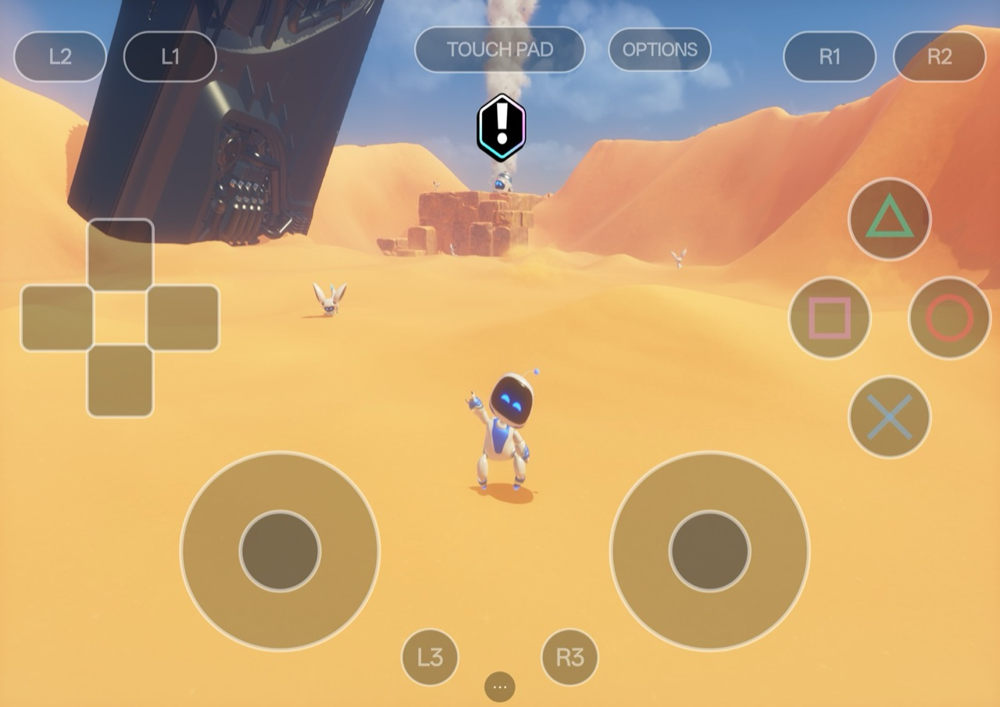
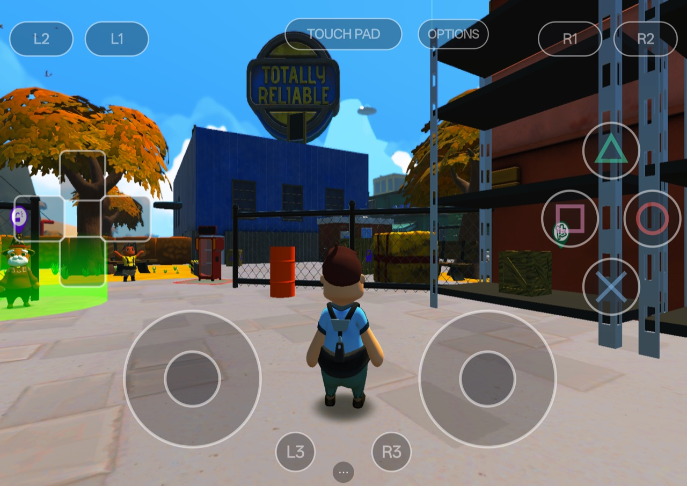
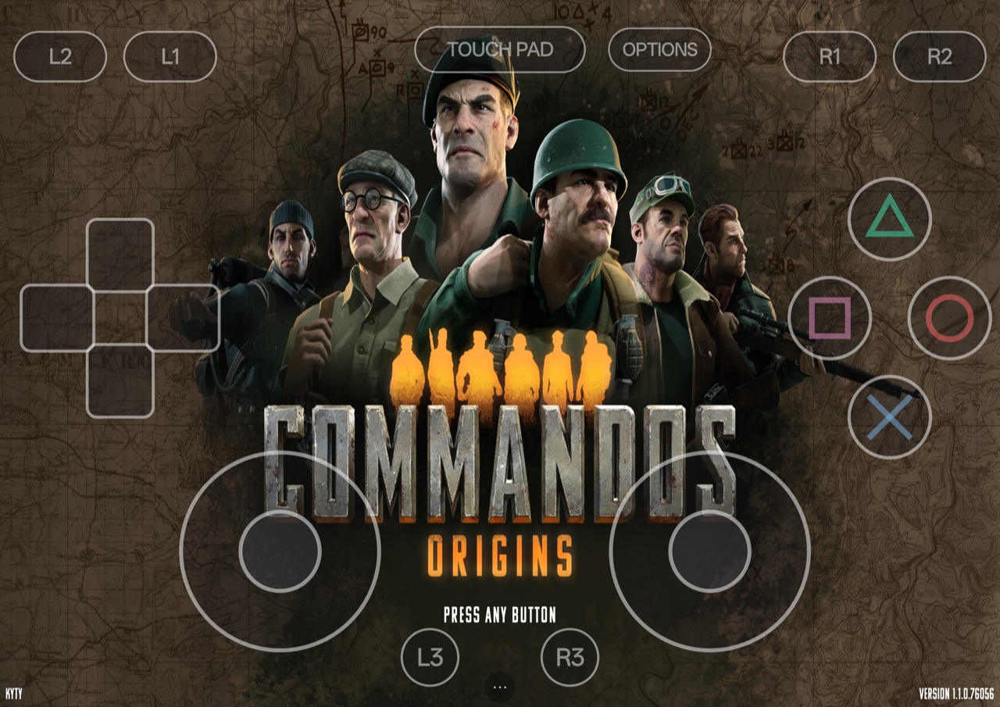
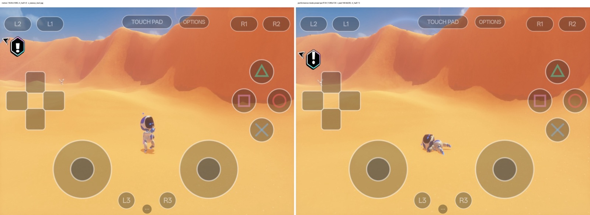

# KytyPS5 Android

**PlayStation 5 games on Android tablets and phones.**

KytyPS5 Android is a port of the [KytyPS5](https://github.com/KytyPS5/KytyPS5) PS5 translation layer to
Android ARM64. The games' x86-64 code runs on an embedded [FEXCore](https://github.com/FEX-Emu/FEX) JIT. Their
GPU work is translated to Vulkan and runs on Qualcomm Adreno GPUs through the open-source Mesa Turnip driver.
It is a separate project with its own goals: speed on mobile GPUs, thermals, touch controls and per-game tuning.

> [!IMPORTANT]
> This project is not affiliated with Sony Interactive Entertainment or PlayStation. It does not distribute
> games, keys or system software. Use only game dumps you own.

## What runs today

Measured on a OnePlus Pad 3 (Snapdragon 8 Elite, Adreno 830):

| Game | State | Speed |
|---|---|---|
| Vampire Survivors | ✅ Playable | ~60 fps |
| Totally Reliable Delivery Service | 🟡 Nearly playable | 28–35 fps |
| Astro Bot | 🟠 Runs, slow | 12–17 fps; ~20 fps in Performance mode |
| Commandos: Origins (Unreal Engine 5) | 🔴 Boots, very slow | ~2 fps |

Full details are in **[docs/android/STATUS.md](docs/android/STATUS.md)**, and **[docs/android/ROADMAP.md](docs/android/ROADMAP.md)** covers what's next.

<table>
<tr>
<td></td>
<td></td>
</tr>
<tr>
<td align="center">Totally Reliable Delivery Service</td>
<td align="center">Commandos: Origins</td>
</tr>
</table>

**Astro Bot, native (left) vs Performance mode (right).** Performance mode runs at 720p with faster lighting. It is an opt-in preset in the launcher.

## Features

- **Launcher:**
  - game library for unpacked folders and `.exfat` images;
  - per-game settings;
  - GPU driver picker (custom Turnip builds via libadrenotools).
- **On-screen controls:** a full DualSense layout with touch pad and sticks.
- **Per-game presets:** ship known-good settings per title, off by default. Examples: UE5 resolution overrides,
  and Astro Bot's Performance mode, which uses a render-size patch plus half-rate lighting.
- **Mobile GPU work:**
  - shader translation tuned for Adreno/Turnip;
  - half-rate ray-traced lighting;
  - workgroup packing;
  - multi-threaded GPU command front-end;
  - thermal-aware clock handling.
- **Diagnostics:** `--perf-stats` per-second performance lines, live knobs and GPU breadcrumbs.

## Requirements

- An Android ARM64 device with a **Qualcomm Adreno** GPU. It is developed and tested on the Adreno 830; other
  GPUs are untested, and reports are welcome.
- **16 GB RAM recommended.** Astro Bot alone uses ~13 GB of system memory on the test device.
- A Turnip Vulkan driver loaded through the launcher. Mainline Turnip v32 is the default.

## Getting started

1. Download an APK from **[Releases](https://github.com/tarek369/KytyPS5-Android/releases)** and install it.
   `Nightly` is built automatically from every push; `v…` releases are milestones. The Turnip GPU driver is
   bundled. To build it yourself instead, follow
   [docs/android/CONTRIBUTING.md](docs/android/CONTRIBUTING.md) (Android NDK 28.2, CMake, Ninja, Gradle).
2. Copy your game dump (a folder, or an `.exfat` image) to the device's `Download` folder.
3. Open KytyPS5 and pick the game in the launcher. Per-game presets such as Performance mode are in its
   settings.

## Contributing

Help is very welcome: performance work, more games tested, more devices tested, launcher UI.

- Start with **[docs/android/CONTRIBUTING.md](docs/android/CONTRIBUTING.md)**. It covers building, measuring
  and the knobs.
- Then pick an item from **[docs/android/ROADMAP.md](docs/android/ROADMAP.md)**.
- Testing a new game? Open an issue with the title ID, how far it gets, fps and the log.

### AI use

Much of this port was developed with AI coding agents working under human direction. Every change is built,
unit-tested and measured on a real device before it lands. Contributions made with AI help are welcome. Say
so in the pull request and describe how you tested.

## Credits

- [KytyPS5](https://github.com/KytyPS5/KytyPS5): the PS5 translation layer this port is built on.
- [Kyty](https://github.com/InoriRus/Kyty) by InoriRus: the original project KytyPS5 grew from.
- [FEX-Emu](https://github.com/FEX-Emu/FEX): the x86-64 JIT (FEXCore). Our local FEX patch is ours alone and
  is never sent upstream.
- [Mesa Turnip](https://docs.mesa3d.org/drivers/freedreno.html) and the community Turnip builds: the Adreno
  Vulkan driver.
- [libadrenotools](https://github.com/bylaws/libadrenotools): custom driver loading on Android.
- [SDL3](https://github.com/libsdl-org/SDL): windowing, input and audio.
- [shadPS4](https://github.com/shadps4-emu/shadPS4): a reference for PS4/PS5 GPU and memory behaviour.

## License

[GNU General Public License version 2](LICENSE) (`GPL-2.0-only`), the same as KytyPS5. Kyty's original MIT
notice is preserved in [`LICENSES/Kyty-MIT.txt`](LICENSES/Kyty-MIT.txt). Third-party components keep their
own licenses.
