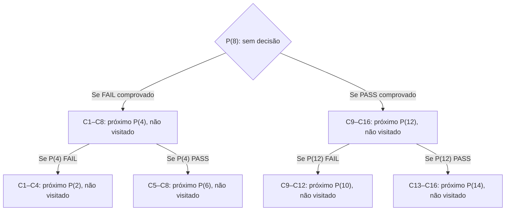
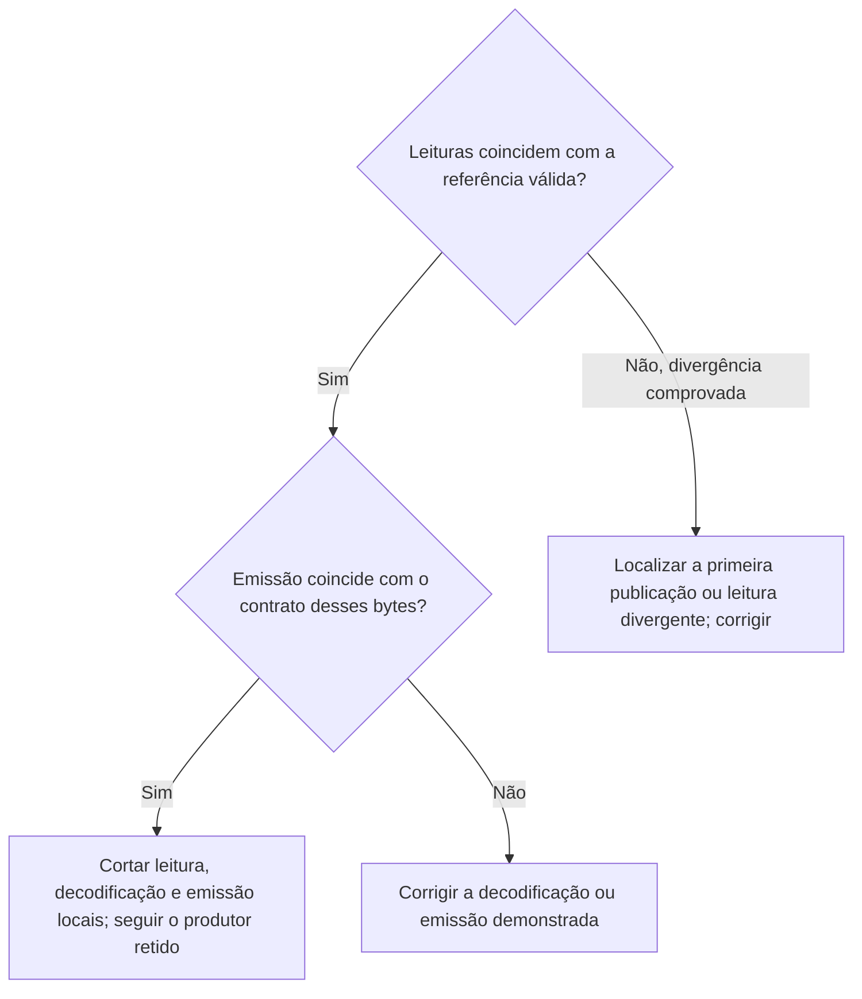

# V3 — investigação binária integral (normativa, substitui V2 e V1)

## #757 — resultado real / contrato ativo #758

- ZIP 20261127-161050, SHA256 c6cde2375d5082e261711c022880d328dac0f499c73b6ae955151f60232a5e0f. Frame 383, submit 11412, P8_USE_84, q8 WG287 lane42, pixel (882,669), stencil 0x56, tile 16710.
- MATCH local: 64/64 coordenadas, stencil, depth; 192/192 leituras de material; 320/320 operações de máscara; 9/9 acumulações; 576/576 operações HDR RGB compatíveis. Não elimina outras waves/filas ou amostragem independente. P8 global permanece historicamente BLOCKED [0,16], zero metades globais eliminadas.
- Replay condicional da ISA original, com valores de amostras observadas e reduções já comparadas: RGB a até 2 ULP float32, mesmo FP16. A luz 0 possui RGB 0.00828048; luz 1, raio ~1.35 contra distância ~1.467; luz 2, flag 0x21 contra bit de categoria 0x20. Essas explicações intermediárias são derivadas da referência, não captura nativa dos loads escalares. A soma baixa não demonstra defeito de iluminação intencional.
- **Único contrato ativo #758:** backing guest estável e autorizado -> slot 2 (224 registros de 384 bytes) -> loads escalares dinâmicos da luz e decisão AND/EXEC. Capturar a mesma fonte antes/depois da cópia e após dispatch, propriedade/geração/offset, e registros realmente consumidos (inclusive rejeitados). MATCH encaminha ao produtor dos valores; DIVERGENCE no campo consumido autoriza localizar/corrigir a publicação ou load; INCOMPLETE não certifica autoridade. Sem alteração artificial de luz.
- Ver [DEMONS_APK_758_V4_LIGHT_RECORDS.md](DEMONS_APK_758_V4_LIGHT_RECORDS.md). #758 preparada, resultado de aparelho ainda não existe.


## V4 — novo roteiro operacional (27/11/2026; prevalece sobre V3)

[Contrato local e recuperação mensurável](DEMONS_V4_LOCAL_CONTRACT.md)
substitui a bisseção P8 como pré-condição. Histórico P8 BLOCKED [0,16],
zero metades cortadas. Não reabrir por associação: 41/41 VS comparáveis,
máscara céu/material complementar exata; a baixa radiância foi medida
nos pixels de material. Testemunha ativa (799,553), tile13899 q8 WG0
local (7,1), P8_USE_93 CS 3dfe402653925fbf. A igualdade local encaminha
a origem do operando, a divergência local autoriza correção fundamentada
sem exigir prefixo inteiro. Todas as demais provas permanecem no escopo.
Nenhum APK gerado por esta revisão metodológica.


## Preparação #757 — executor ISA e suporte causal, 27/11/2026

**P8 BLOCKED [0,16]; nenhuma metade global eliminada. #757 não disparada.**
A referência offline agora executa o shader guest 3265b01ed00a5c01 com
trampolins de diagnóstico para MIMG e amostragem lógica independente do
tradutor SPIR-V do Android. 64/64 pontos distribuídos e 4/4 pixels do quad
central coincidem bit a bit com o flip real de #756. O pixel (960,540)
depende de 16 texels da cena e um do overlay. Substituição sintética fora
desse suporte não o altera; dentro altera. O motor bilateral executa ambos
os resultados de teste através do compositor real: FAIL [0,8] e PASS
[8,16]. Os produtores anteriores nesses testes são sintéticos e não
certificam o jogo. Rejeita censo ausente, fronteira errada, observação ausente
e diferença fora do suporte. O executor também passa teste de leituras
dinâmicas repetidas no mesmo PC, preservação de SCC e rejeição de dados
incompletos. Sem alteração do pipeline de jogo.

Lacuna concreta ainda aberta: P8_USE_242/243 não têm operandos escalares,
imagem por versão e cobertura de primitiva completos. O segundo usa
arrays/3D/LOD ainda não implementados na referência de amostragem.
O prefixo real C1–C8 permanece sem autoridade independente; portanto nem
PASS nem FAIL reais podem ser inferidos dos testes. Não gerar APK que
apenas colete mais logs sem completar os dois caminhos. A instrumentação
ISA é host-only, não altera o shader do jogo. Ver
[DEMONS_P8_757_PREPARATION.md](DEMONS_P8_757_PREPARATION.md).

## Atualização prioritária — captura #756, 27/11/2026

**P8 BLOCKED [0,16]; zero metades globais eliminadas. Não disparar #757.**
A captura real frame427 já foi analisada. O replay analítico do compositor
reproduziu 2066048/2073600 pixels exatamente, restantes com diferença máxima
1 LSB RGB. A testemunha final (960,540) tem baseline e observação iguais;
a sensibilidade à cena foi exercitada. O próximo passo é fechar o suporte
causal dos escritores da cena P8_USE_242/243, não repetir certificados locais.
O método inverso, resultados, limitações e condições bilaterais estão em
[DEMONS_APK_756_RESULTS.md](DEMONS_APK_756_RESULTS.md), que prevalece sobre
os estados históricos abaixo. A referência analítica não certifica DCC ou
P8; nenhum APK foi gerado.


## Estado atual

Atualizado em **27/11/2026**, após análise offline da captura #756 (130905), revisão f6d4030, modo F; sem decisão global. O par integral do compositor foi analisado, e a investigação segue pelo escritor da cena, sem nova build.

**Nó global ativo: P(8) BLOCKED. Intervalo [0,16]. Metades eliminadas: 0.**
Na #753, o contador 86016 e leitura/emissão CP coincidem no mesmo caso.
O draw599 precede a fronteira por um frame: versão38650 e hash integral
observado vinculados a 43 leituras em frame359. POS0 bitwise 76/76 no
executor RDNA1 e recorte MRT0 produz o valor dominante 0xff000000 com os
RGB retidos. A cobertura/produção dos inputs e o sufixo até o flip não
estão certificados. O overlay integral e o estado guest do compositor
estão ausentes. Os testes executáveis PASS/FAIL de cones finitos não são
uma decisão sobre o jogo. Consultar o balanço e o método bilateral.

### Prioridade operacional: decidir P(8)

**Correção de foco solicitada pelo usuário em 26/11/2026:** fechar comparações
locais não basta para cumprir a primeira divisão. O objetivo da próxima build
diagnóstica é produzir uma decisão de **P(8)**. As provas locais permanecem
válidas, mas só justificam instrumentação adicional quando entram em um caminho
concreto que decide esse nó; seguir indefinidamente mais um produtor não é uma
bisseção global.

A auditoria da #746 mostrou a deficiência do preparo: os controles verificaram
READ/EMIT, não os dois desfechos de P(8). **MATCH dos 60 bytes não certifica
C1..C8.** Uma divergência de leitura/emissão pode provar um erro antes da
iluminação, mas sua contribuição para o sintoma ainda precisa ser demonstrada
na cadeia de versões do mesmo episódio. O batch, os targets e a ordem estão
vinculados; os 98.304 índices
da execução anterior não são uma referência de cobertura com as entradas do
ciclo zerado. Portanto, **#746 é aquisição local, não uma decisão bilateral de
P(8)**; preservar o APK e aproveitar a captura sem antecipar esse alcance.

Há também uma deficiência executável concreta:
[`prelight_v3_gate.py`](tools/prelight_v3_gate.py) inicializa G0/P8 como BLOCKED
e não contém transição para PASS/FAIL. O oráculo de vértices só anexa decisões
locais. O script audita transporte e lacunas; outro ZIP íntegro não cria o
comparador global ausente. Não substituir esse mecanismo por flags declaradas.

O vínculo com a saída final também tem uma lacuna concreta na #745: a perda
de albedo ocorre no frame 202 e a janela fecha no 207, mas o monitor da cena
`0x281a80000` registra 64/64 amostras iluminadas no frame 209, 1/64 no 233 e
aciona `bright_to_dark` no 281. Não são certificados da imagem inteira nem
prova de independência entre os eventos; mostram que a identidade temporal,
de versões e de contribuição entre a perda retida e o sintoma final ainda
precisa ser estabelecida. Preservar o caso e verificar essa ligação antes de
promover um erro local a causa. Ver [evidência da #745](DEMONS_APK_745_RESULTS.md).

| Resultado necessário em P(8) | Prova que deve decidir o ramo | Evidência atual que não basta |
| --- | --- | --- |
| **FAIL → [0,8]** | Contraexemplo independente em C1..C8, com os mesmos inputs/versões e efeito demonstrado na contribuição da testemunha ao sintoma. | Count0 antes da perda, pixels pretos ou uma diferença de leitura sem demonstrar o efeito no mesmo episódio. |
| **PASS → [8,16]** | Certificado do prefixo relevante até C8, incluindo comandos que determinam quais invocações existem, produtores e versões, preservando a divergência posterior da mesma testemunha contra referência independente. | MATCH dos 45 POS0, dos 60 bytes ou de uma saída isolada; isso não certifica produtores, invocações omitidas ou operações não comparadas. |

Um FAIL local ligado ao sintoma elimina C9–C16 como localização da **primeira**
divergência dessa testemunha; não certifica ausência de erros posteriores.
O vínculo pode ser demonstrado por propagação/replay ou intervenção mínima
validada, sem exigir restaurar toda a imagem para aproveitar o contraexemplo.

Antes de outra build, o preparo deve apresentar o verificador executável e o
contrato de aquisição dos operandos, versões e vínculos a obter para **ambos**
os resultados, com os pontos de captura e verificação, exercitando
PASS, FAIL e falhas de aquisição. Usar primeiro os dados já disponíveis e
completar somente o cone necessário da mesma testemunha. Registrar o mapa de
cada dado necessário para seu ponto de aquisição e sua verificação. A análise atual ainda
não contém esse verificador global; documentar a meta não equivale a implementá-lo.
Não se exige obter a resposta antes de capturar, um PC idêntico ou um rastreador
CPU universal. Se uma aquisição falhar, reparar sua deficiência concreta; se
surgir divergência comprovada, corrigir a operação sem abrir novos galhos.

### Árvore global e decisões ainda não visitadas

As setas abaixo são **condicionais**, não decisões já obtidas. Ambos os lados
de P(8) permanecem possíveis. Nenhum P(4), P(12) ou nó inferior foi selecionado.



C1–C8 cobrem a origem dos comandos e recursos até o G-buffer completo;
C9–C16 cobrem iluminação, composição, pós-processamento e apresentação.
As 16 classes e as divisões seguintes continuam definidas em
**Auditoria de completude e invariantes** e **Árvore fixa**, abaixo.
Um certificado local não se soma a outros como se cada um eliminasse uma
metade dessa árvore.

### O que foi cortado, o que continua aberto e por quê

| Build | Operações retiradas como primeira divergência, no escopo comparado | Corte global | Lacuna e correção concreta |
| --- | --- | --- | --- |
| **#744** | Certificados do fundo e dos fixups preservados; dois VS do fundo reproduzidos offline. | **Nenhum.** | Faltavam inputs, índices e módulos do foreground. A #745 corrigiu seleção pelo clear executado, aquisição dos operandos e exportação obrigatória. |
| **#745** | **45 draws / 73.580 vértices / 294.320 componentes POS0 iguais bit a bit.** Fetch/cálculo/export de posição dessas invocações não explicam uma diferença em relação à ISA com os mesmos inputs. | **Nenhum.** | Os três registros de argumentos CPU em `0x21de00078` não tinham seus **60 bytes e versão independente** capturados. A #746 preserva consumo original, referência por byte, emissão, extremos do episódio e produtores/transferências observados. |
| **#746** | **Ainda nenhum resultado novo do aparelho.** O APK entregue contém a comparação local READ/EMIT validada antes da build. | **Nenhum registrado; aguarda captura.** | Além da captura pendente, o preparo não fechou um mecanismo bilateral de P(8). Aproveitar os resultados locais; construir a decisão do nó ativo antes de outra build diagnóstica. |

Os 45 draws da #745 incluem a **revalidação** dos VS do céu: não são 45 cortes
inéditos. A máscara do céu (1.439.342 pixels alterados / 658 preservados), os
**34 fixups** e as **32 operações cb3b** também foram revalidados. Não reabrir
essas operações sem nova evidência que invalide o certificado no seu escopo.
Os cinco draws sem comparação POS0 nativa completa têm classificação explícita
nos [resultados da #745](DEMONS_APK_745_RESULTS.md); não foram contados como PASS.

### Decisão local preparada na #746

**Caso mantido:** o batch de três registros de 20 bytes observado em
`0x21de00078`. Na #745, o filho0 usa 98.304 índices no pai **54823** e passa a
zero nos pais **55986/56594**, antes da perda de albedo. Os números identificam
a execução anterior; a #746 seleciona o episódio pela identidade e pela perda,
sem exigir que endereços ou números de comandos se repitam.

As duas perguntas binárias abaixo usam os valores consumidos originalmente,
a referência da versão correspondente e o tuple efetivamente emitido. O ramo
de leitura divergente exige bytes GPU autoritativos, identidade e ordem
suficientes; uma diferença tardia em página CPU-dirty é **UNSTABLE**, não uma
prova de leitura errada.



**INCOMPLETE ou UNSTABLE não escolhem um ramo causal.** Registrar o record,
range, versão ou arquivo que faltou; manter os resultados válidos dos demais
records; examinar primeiro os eventos já retidos. Se os dados não bastarem,
corrigir a janela, associação ou aquisição específica e reproduzir a deficiência
em fixture antes de outro APK. Se os extremos não estiverem ligados à perda, preservar
o certificado local sem promovê-lo a causa do sintoma. O
[contrato da #746](DEMONS_CP_INDIRECT_CAPTURE.md) e o
[balanço por build](DEMONS_BUILD_ELIMINATION_LEDGER.md) detalham essas decisões.

Quando houver MATCH, avançar pelos produtores já retidos no mesmo ZIP até a
próxima comparação possível. Quando houver a primeira divergência comprovada,
implementar sua correção. A aquisição dessa aresta não depende de já possuir
uma resposta global de P(8), captura externa de PC ou trace CPU universal.

## Continuidade operacional — 26/11/2026

**Balanço obrigatório por build:**
[cortes obtidos, ausências de corte, causa e correção da aquisição](DEMONS_BUILD_ELIMINATION_LEDGER.md).
Revalidação, certificado local e corte de metade global têm contagens separadas.

**Entrega atual: APK #746 compilado, assinado e verificado**, revisão
`4e321c2dbedcab17085c1af6ecf0d0f4f8345afe`, versionCode 846;
[verificação do artefato](DEMONS_APK_746_VERIFICATION.md). Aguarda captura do aparelho.
A última execução analisada continua sendo a **#745**, núcleo `4a94749`,
ZIP `20261126-132544`, modo F.
[Resultados completos da #745](DEMONS_APK_745_RESULTS.md).
Não interpretar entrega do APK ou matches locais como correção visual
comprovada ou decisão global de P8.

### Poda obtida com #745 e próxima comparação

O ciclo 55824→56618 corresponde aos mesmos 50 draws de #744; operandos e
posições foram recalculados para a execução nova. **45 draws / 73.580
vértices / 294.320 componentes XYZW coincidem bit a bit com a ISA guest.**
Os outros cinco têm referência-only ou zero invocações explicitamente
classificados. Os buffers declarados estão completos e a exportação contém
375/375 dependências obrigatórias. Não pedir novo teste para opcodes desse
slice, VS2337 ou o céu.

A máscara local do céu foi recalculada: 1.439.342 pixels de depth alterados
e albedo preto; os 658 restantes são exatamente os pixels RGB não zero.
Os 34 fixups indiretos e 32 operações cb3b registradas também coincidem.
Esses certificados removem as respectivas operações como primeira
divergência; não certificam automaticamente seus produtores anteriores.

**A próxima aresta é o batch de cenário em `0x21de00078`: três records de
20 bytes, lidos no fallback CPU.** O primeiro passa de 98.304 índices no
comando 54823 para zero nos comandos 55986/56594, antes da perda pelo céu.
O fallback já existia quando a contagem era não zero. Os 60 bytes da fonte
e sua versão nativa não estão no ZIP; f0c140 escreve outro recurso.
[Contrato da aquisição e validação prévia](DEMONS_CP_INDIRECT_CAPTURE.md).

| Comparação local | Consequência para a cadeia observada |
| --- | --- |
| Leitura difere de bytes GPU autoritativos, com identidade e ordem suficientes | Fixar a primeira publicação/transferência/leitura divergente e corrigir; não culpar a produção guest de zero antes de resolver essa divergência. |
| Leituras e referência coincidem, mas os argumentos emitidos violam o contrato | Fixar e corrigir a decodificação/emissão de count, índice, base/offset ou instância indicada pelo contraexemplo. |
| Bytes consumidos e argumentos emitidos coincidem com a versão independente | Eliminar essa leitura/decodificação como primeira divergência no escopo comparado; seguir a origem real do registro já capturada, mantendo certificados de posição e raster. |
| Captura truncada, versão alterada ou diferença tardia em página CPU-dirty | Reportar INCOMPLETE/UNSTABLE, o range e o motivo; reparar a aquisição específica, sem fabricar igualdade ou divergência nem impor veto global de aquisição. |

Preservar último não zero e primeiro zero juntos, com token do comando pai,
filhos, dirty/pending, publicações e bytes de escritores/transferências
observados. Guardar valores efetivamente usados **antes** de qualquer
readback diagnóstico. Congelar por registro e coletar somente depois dos
três consumos; selar o par no trigger já existente de perda de albedo.
Um velho espelho Vulkan de dados CPU-dirty não é
referência autoritativa. Um descritor que cobre o range ou um fault de página
é candidato; não equivale a último store comprovado. Nenhum rastreador CPU
universal ou captura externa de PC é pré-condição para essa comparação.

A falta de certificação integral de P8 não é uma proibição de adquirir os
operandos de uma comparação concreta. O usuário corrigiu expressamente esse
bloqueio circular nesta sessão. Mantêm-se a testemunha #741/#744, as classes,
os certificados locais e o intervalo global ainda não decidido. Não se exige
uma captura de PC ou um emulador de referência completo para continuar.

A comparação executada na #745 foi **bytes consumidos → posição guest →
posição nativa**, nos draws do mesmo ciclo iniciado pelo clear executado e
encerrado pela primeira perda. `tools/prelight_vertex_oracle.py` decodifica
a ISA gfx1010 e avalia o slice de EXP POS0 com os buffers nativos e as leituras
SRT registradas no instante de materialização. Não usa as colunas de matriz,
posição de entrada ou XYZW nativo como resposta esperada.

| Resultado da comparação | Redução comprovada e próxima ação |
| --- | --- |
| POSITION_MATCH | Para as invocações e bytes comparados, remover o cálculo/fetch desse VS da lista de operações divergentes. Seguir a origem dos operandos ou a próxima operação já delimitada da mesma testemunha. |
| POSITION_DIVERGENCE | Fixar draw, componente, instrução EXP, bits esperados/observados e loads do slice. Investigar somente a tradução/fetch/aritmética desse contraexemplo, conferindo modo numérico, até a primeira instrução divergente. |
| UNSUPPORTED_DRAW | Informar a instrução ou faixa exata ausente; preservar os resultados dos demais draws. Um novo opcode pode ser implementado offline com a ISA e os operandos já exportados. |

Isso decide uma aresta real dentro da investigação de G0/P8. Não transforma
um resultado local em PASS global, nem seleciona o ramo de iluminação por
exclusão incompleta. A promoção para uma metade global requer o vínculo com
o sintoma conforme as regras abaixo. O auditor `prelight_v3_gate.py` não é
um mecanismo de autorização de builds e não tem mais um veto incondicional.

Antes da compilação, o novo oráculo reproduziu os dois VS do céu da #744:
38 vértices, 152 componentes XYZW bit a bit. A máscara raster já certificada
permanece preservada. Na #737, W0 reproduz os NaNs; W1 identifica a leitura
0xc8 cujo slot2 não contém os 448.296 bytes necessários. Estes últimos são
controles do mecanismo, não novas testemunhas do defeito de iluminação.

O APK #745 completa a correção da captura: admissão após o clear
executado, orçamento que inclui os blobs, leituras GPU em lote por draw,
posições de todos os VS estruturalmente suportados, ISA guest inclusive em
cache hits, SPIR-V original e ligado, fecho obrigatório de exportação com
SHA-256 e motivos explícitos de ausência. A captura guarda os operandos dos
draws seguintes do mesmo ciclo, permitindo continuar offline sem uma build
para cada shader ou hipótese. O diagnóstico do aparelho confirmou a suficiência
dessa captura para os 45 draws comparáveis; não demonstrou correção visual.
Não há alteração artificial de luz, albedo, contagens ou depth.

## Auditoria de completude e invariantes
V2 assumia falha pré-iluminação sem prova G0 e não cobria iluminação,
pós-processamento e apresentação. V3 cobre o grafo causal da imagem
inteira, inclusive se o albedo zero for legítimo. Não confundir cobertura
de classes com captura exaustiva ou garantia de causa única.
G0: fixar o sintoma final (pixel/amostra/ciclo/versão), mesma entrada
guest, configuração, câmera/save, objeto e saída esperada independente
(ISA/contrato/replay com operandos reais). Se não reproduzir ou não houver
oráculo suficiente, BLOCKED; manter o nó, não assumir erro de cor ou
selecionar por associação. Os frames 311/312 da #737 são âncora temporal
observada, não verdade esperada. Mesmo frame host não garante mesmo
ciclo guest. Capturar ambos extremos, comandos, versões e publicação.
Classes de primeira divergência do slice causal:
C1 estado inicial/asset/streaming/decompressão/CPU/HLE/FEX/visibilidade,
   comando/dispatch guest, predicação, emissão/ordenação e argumentos.
C2 fetch/loads/índices/atributos/SRT/descritores/BDA/versão de recursos.
C3 VS/LS/HS/DS/GS/mesh, cálculo e export.
C4 montagem/topologia/clipping/culling/viewport/scissor/raster.
C5 testes de fragmento/discard/depth/stencil/coverage, HTile e produtores.
C6 material/PS, interpolação/sampling/ISA/exports.
C7 MRT/clear/load/store/resolve/copy/blend/máscaras/formatos/escritores.
C8 publicação e consumo do G-buffer COMPLETO (todas as camadas/depth/
   normais/materiais, seleção/alias/layout/versão/coerência).
C9 entradas de iluminação (luzes, sombras, BVH/rays, probes, radiância,
   atlas, constantes, produtores, cache/asset).
C10 seleção de tiles, argumentos e execução de dispatch/filas.
C11 semântica do shader de iluminação, loads, sampling, controle de fluxo.
C12 acumulação/precisão/exportação/armazenamento HDR e publicação.
C13 composição, transparências, passes de fog/forward, UI e blend.
C14 exposição/tone map, correção de cor, pós-processamento.
C15 reconstrução temporal/upscale, resolve, conversão, scanout/present.
C16 entrega ao Android (swapchain/AHB/surface, sincronização, compositor,
    formato/cor/transformação), inclusive output errado por host/driver.
Em cada classe, erros de tradução, hardware/driver, memória, ordenação,
coerência, DMA, versão, recursos ausentes, OOB, alias, concorrência e
estado incorreto pertencem à operação afetada, não a linhas paralelas.
Histórico temporal/feedback é DAG de versões: arestas cruzam frames.
Estado/asset incorreto tem ancestral em C1 ou no produtor efetivo;
não tratar coincidência de hash, zero/NaN, ou mudança de câmera como erro.
Testar funções/ISA/cópias com mesmas entradas; PC sem mesma captura não
é oráculo. Se depende de concorrência, preservar ordem parcial/versões
e testar interleavings; não assumir uma ordem total por timestamp.
Causas múltiplas: localizar primeira divergência causal de testemunha
fixa, corrigir e revalidar até saída final; residual comprovado segue
a mesma árvore, reutilizando certificados ainda válidos. Não reabrir
irmãos eliminados sem invalidar certificado por nova evidência.
Uma operação local correta não prova todos os seus produtores corretos.
Uma divergência local sem caminho causal até sintoma não é causa raiz.
## Árvore fixa
P(k)=prefixo cumulativo C1..Ck certificado no cone causal da testemunha
(inclui dependências/recursos relevantes, sem depender de contagens
globais). Se duas saídas compensam erro intermediário, não certifica
prefixo. PASS/FAIL requer prova; missing/unsupported=BLOCKED.
Com G0 e P(16) FAIL demonstrados, [0,16], P(0)=PASS. Primeiro P(8).
PASS: [8,16]; FAIL: [0,8]. Depois P(4) ou P(12), depois P(2)/P(6)/
P(10)/P(14), depois ímpar. Quatro decisões válidas isolam classe,
não quatro builds garantidas: custo do oráculo/captura importa.
Quando hi-lo=1, bissectar operações finitas da classe com extremos
certificados, DAG de versões, prefixo monotônico, mesma testemunha.
Nunca trocar de ramo em BLOCKED; adquirir próximos operandos juntos
na mesma build quando viável. Não inventar expectativa de gameplay.
## Primeira build V3 (substitui #738)
#738 falhou na compilação e foi abandonada; restaurar código renderer
da #737 validada e remover sondas W0/W1 do modo F. Janela circular
12 MiB mantém eventos prévios; na primeira queda observada na MESMA
fila (0 ou 33, após >=50% de cor, <=10% atual), retém a janela e
captura até dois frames posteriores, com drenagem até +4.
A queda é gatilho, não certificado. Exporta imagens R32_UINT completas
antes/depois (mesma fila), identidade/tick/versão/hash, amostras e
população completa por draw de material, comandos e recursos ligados,
queries originais por frame e replay read-only quando suportado,
bridge de G-buffer/HDR, outras camadas/depth, tiles e dados bound
antes/depois do mesmo dispatch; export raiz tem prioridade.
Lacunas: replay de cobertura não é replay guest integral; shaders
sem variante, efeitos laterais, buffers grandes, recursos ausentes,
pixel esperado e pós-passes sem captura ficam explicitamente bloqueados.
Snapshot síncrono pode alterar timing; registrar perturbação, não
certificar sincronização de produção. Limites de export e pré-história
evictada explícitos. Teste unitário verifica todos 16 caminhos de
bisseção, BLOCKED, fila do gatilho e encerramento de janela.
Nenhuma mudança semântica de renderização ou fix especulativo.
Estado: G0/P8 BLOCKED, primeira divisão não selecionada.

## Auditoria executável de #741/#744 — 26/11/2026

A [auditoria reproduzível](DEMONS_V3_AUDIT_2026_11_26.md) preserva G0/P8,
o mesmo ciclo e o intervalo potencial [0,16]. Nenhuma metade global foi
eliminada. `tools/prelight_v3_gate.py` confere o fecho da captura e registra
P8 BLOCKED nos dois ZIPs reais; não aceita booleanos de certificação
como substituto de um replay independente. O backend integral C1..C8 ainda
não existe, e o gate declara essa ausência. Esse script é auditoria de
de evidências. Uma auditoria legível retorna exit 0; dados inválidos retornam
exit 3. `--vertex-oracle` executa as comparações locais acima e as inclui no
relatório, sem aceitar um arquivo externo de PASS/FAIL.

Clear executado seleciona corretamente 40367→40979 (#741) e
39624→40091 (#744), 50 draws em cada ciclo. Faltam 3.304.608 bytes de
buffers por usos declarados (3.214.628 após excluir zero invocações),
269.592 índices diretos e 20 dos 36 shaders guest do ciclo (16 necessários
continuam ausentes após excluir os quatro dos indiretos sem invocações). Os dois
indiretos têm argumentos efetivos [8907,0,0,0,0], compatíveis com zero
trabalho; não exigir VS/índices não consumidos nem certificar seu produtor.

Certificados locais reproduzíveis, sem alargar seu escopo:
`tools/prelight_sky_replay.py` reproduz a máscara D32 inteira #744 com
zero divergências, 1.439.331 alterações e erro numérico máximo 2,375e-9;
usa XYZW capturado, não o VS guest como referência.
`tools/prelight_position_formula_replay.py` reproduz as quatro expressões
XYZW de VS8685/variant7843 sob a premissa de loads idênticos e lane ativa;
não certifica fetch/EXEC/precisão/visibilidade. Ambos mantêm P8 BLOCKED.

A staging recebeu regressão adicional da retenção: primeiro reconhecer
o clear executado/resetar o orçamento, depois admitir o payload capturado
antes da aquisição. Um ciclo anterior cheio não pode expulsar o primeiro
registro do novo ciclo. Correção de instrumentação, sem alteração da luz.
A limitação dos filtros/caps e dos operandos de posição foi posteriormente
corrigida e validada no APK #745, conforme o início deste documento.
A ausência de um oráculo integral não impede a comparação executável da
próxima aresta.
---
# Histórico V2 e V1 (somente evidência)
# Demon's Souls PPSA01341 — árvore operacional V2: bisseção causal
**Normativa a partir de #738.** O histórico V1 abaixo é evidência, não autorização
para escolher outro ramo. A árvore V1 misturou testemunhas W0/W1, expandiu folhas
sem estabelecer causalidade global e não resolveu a raiz. Não repetir isso.

## 0. Fixar o caso e os extremos ANTES de descer
ZIP #737 20261126-102508, owner 0x287ae0000, layer0 mip0, 1600x900.
Consumer q33 f311 submit8741 seq2729 version10716: 1440000 RGB não zero.
Consumer q0 f312 submit8782 seq2730 version10900: 651 RGB não zero;
q33 seq2732 confirma 651. f313 q33 seq3080: 672.
É a primeira queda observada depois da janela de população plena f231–311,
não uma prova de que todos esses pixels deveriam manter a cor entre frames.
O frame 312 tem 45 guest_command, 38 draw_prepared, 38 draw_execute,
mas nenhum draw_before/draw_after nessa captura. O journal termina com
1792 eventos perdidos, 26 full samples perdidos; a fronteira não foi
reconstituída. F348 já é posterior (zero), e W1 volta a produzir cobertura
em f503 embora o problema global persista. W0 e W1 não qualificam como
testemunha de causa global; manter seus resultados locais no histórico.

G0 (pré-condição, não ramo causal): fixar uma amostra/primitive/objeto que
contribui para a falha, versão da imagem, draw/ciclo guest, índices,
instância, câmera, estado e inputs. Obter saída esperada para os mesmos
dados via contrato guest/replay independente. Se a testemunha não estiver
demonstrada, permanecer em G0; não selecionar outro nó por associação.
A transição f311→312 é a âncora temporal para adquirir essa testemunha,
não o oráculo de cor. Frames absolutos mudam por instrumentação. Usar
mesmo save/configuração e evento guest de transição, registrar intervalo
e dados reais; se não reproduzir, não comparar cenas diferentes.
P06 e demais podas V1 valem apenas para as operações e inputs certificados.
Se a expectativa de albedo falhar e o defeito estiver depois do G-buffer,
G0 não autoriza declarar pré-iluminação provada. Uma nova árvore do domínio
correto exige demonstrar essa fronteira, não seguir pistas alternativas.

## 1. Espaço de busca fixo e predicado cumulativo
C0 entrada/contrato certificado (PASS).
C1 emissão/execução guest: visibilidade, comandos, argumentos, instâncias.
C2 fetch/loads: índice, vértices, descritores e dados, produtores e versões.
C3 saída VS/estágios geométricos: cálculo e export XYZW/clip.
C4 montagem, clipping, viewport, culling, raster: cobertura esperada.
C5 testes de fragmento: discard, depth, stencil, coverage e seus operandos.
C6 valor de export material: ISA/PS e dados efetivamente lidos.
C7 valor gravado: MRT, máscara, formato, blend, clear, store e escritores.
C8 publicação/consumo: versão/alias/layout/barreira, bytes entregues à luz (FAIL).

Cada classe cobre a primeira falha do contrato daquela fronteira para
a mesma testemunha. Dependências fora da linha (ex.: stored depth,
texturas) pertencem ao contrato da etapa que as consome; se a classe
for selecionada, construir DAG de produtores, ordenar topologicamente
as operações causais e bissectar o ancestral certificado da falha.
Não confundir um valor final coincidente com prefixo correto: P(k)=
todas as fronteiras C1..Ck relevantes certificadas com dados reais.
P(k) é cumulativo e monotônico; testar apenas saída Ck pode esconder
compensações, overwrite ou entradas erradas. Um mismatch upstream
suficiente certifica FAIL; ausência de captura é BLOCKED, não FAIL.
A prova de prefixo pode exigir replay e verificação de várias fronteiras,
não prometer um único contador ou uma build por decisão.

Estado imutável por testemunha: lo=último prefixo PASS, hi=primeiro prefixo
FAIL certificado; iniciar [0,8] somente com G0 e C8 demonstrados.
m=floor((lo+hi)/2). P(m)=PASS -> lo=m; P(m)=FAIL -> hi=m.
P(m)=BLOCKED -> manter [lo,hi] e adquirir exatamente as entradas faltantes.
Quando hi-lo=1, a classe hi está isolada; não abrir irmão. Três decisões
suficientes para oito classes SE os predicados estiverem disponíveis;
não é garantia de três compilações nem de uma causa única global.
Se o primeiro erro não explica a falha final, não fabricar causalidade:
testar regressão da mesma cadeia, manter a testemunha e registrar que
o erro isolado não explica o sintoma; não reabrir irmãos por suspeita.

```
R [0,8] P(4): prefixo até cobertura raster correto?
  N A [0,4] P(2): prefixo até fetch correto?
    N A1 [0,2] P(1): emissão correta?
      N C1 emissão / S C2 fetch
    S A2 [2,4] P(3): saída VS correta?
      N C3 VS / S C4 raster
  S B [4,8] P(6): prefixo até export material correto?
    N B1 [4,6] P(5): testes corretos?
      N C5 testes / S C6 PS
    S B2 [6,8] P(7): valor gravado correto?
      N C7 store / S C8 publicação
```

## 2. Descida obrigatória após isolamento da classe
Dividir o conjunto finito de operações relevantes da classe em duas
metades por custo/evidência, ou número de operações quando equivalente.
Fixar o mesmo input/estado e a ordem causal; certificar extremos e o
prefixo intermediário. Ex.: classe C3: 64 operações relevantes no slice,
intervalo [0,64], testar prefixo 32, depois 16 ou 48, etc. Se a falha
for um load, o slice inclui endereço, bytes, versão e produtor; não
trocar para uma malha de outro frame. Se várias entradas são necessárias,
verificar prefixo topológico, não supor independência nem seguir um
endereço por mero overlap. Repetir até uma operação concreta com
entrada, semântica guest, resultado esperado e observado. Corrigir
e verificar a mesma testemunha, e depois a falha global. Sem fix por
NaN, alteração de constantes, luz artificial ou inferência de câmera.
Não reabrir grupo eliminado salvo nova evidência contraditória,
registrando exatamente qual certificado foi invalidado.

## 3. Próximo passo e controle de custo
ESTADO ATUAL: G0 BLOQUEADO; [0,8] apenas espaço potencial. N00 antigo não
resolvido. Nenhuma classe global eliminada por W0/W1. #738 já disparada
antes da revisão; pode fornecer evidência local, não define o próximo
nó. Esta revisão é docs-only, sem nova build automática.
Próxima aquisição, se necessária: ancorar no primeiro evento de queda
do consumer layer0 depois de população plena, em vez de fase tardia.
Manter buffer circular compacto de eventos reais (clear/load/store,
draw/dispatch, cópia/publicação e versão); preservar a janela anterior
à queda e o ciclo da queda, com snapshots de amostras e dados suficientes
para estabelecer G0 e avaliar P(4) por replay. Capturar operandos de
fronteiras dependentes na mesma execução quando disponíveis. O gatilho
por população serve apenas para retenção, não prova de erro. Não usar
budget consumido por logs W0/W1. Verificar completude e export antes
de interpretar; se não houver referência, explicitar bloqueio e não
criar build incremental por suspeita.
Ledger obrigatório por decisão: ID testemunha, versão/recurso,
intervalo antes, mid, PASS/FAIL/BLOCKED, prova e arquivo, intervalo
depois, subárvore podada, custo e lacunas. Somente um intervalo ativo
para essa testemunha. Nenhuma mudança de ramo por curiosidade.

---

# Histórico V1 (somente evidência; não usar como roteiro operacional)
# Demon's Souls PPSA01341 — árvore binária causal pré-iluminação
Versão 1.0, etapa 1: construção e poda por evidência. Não é uma correção
de renderização e não autoriza uma build por hipótese. A árvore governa
a próxima investigação, substituindo a escolha livre de suspeitos.
Fontes: DEMONS_CAUSAL_MATRIX.md, DEMONS_PC_RENDER_PARITY_2026_11_25.md,
ZIPs F 222007, 223802, 224726, 230251, 231956, 233709 (builds #720–725).
Revisões/identidades dos ZIPs constam na matriz. Os dados foram
reconferidos diretamente nos arquivos de albedo e geometria #721–725.

## Raiz concreta e limites
#721 223802 fase 0 f190–191: 1.440.000 palavras de albedo não zero em cada
um dos quatro registros. Fase 1 f286–287: 41 draws de material, todos
com zero amostras aprovadas, albedo zero antes/depois de todos, nenhuma
palavra alterada; os 42 registros originais de escrita de depth sem layer0
no attachment observado também têm zero amostras aprovadas (41 draws
de cenário mais um registro adicional). Fases 2/3: 475 perdas de palavras
não zero, atribuídas a 552d823d, depois da fase de início; não são causa
demonstrada do início da perda.
#725 233709 fase 0 f211–212: 1.440.000 não zero. Fase 1 f283–284:
1.154 -> 1.252, 42 draws, 329 ganhos e 231 perdas, zero discrepância
de contagem entre snapshots consecutivos. Fase 2 f331–332:
88.328 -> 88.518, 46 draws, 190 ganhos, zero perdas. Fase 3 f474:
42.699 -> 42.853, 23 draws, 631 ganhos, 477 perdas. 552d823d f474
passa 1.397.147 amostras, mas modifica a contagem não zero de 43.330
para 42.853. Cobertura não é sinônimo de albedo válido. As fases não
constituem captura contínua nem mesma câmera. Não se certificou uma
palavra errada versus uma referência guest para um pixel em particular.
A ausência de cor antecede a iluminação; a primeira divergência causal
ainda não foi localizada. A árvore inclui tanto produção ausente quanto
perda/publicação posterior; nenhuma dessas classes é presumida verdadeira.

## Poda de operações (não podar seus operandos nem generalizar)
P01: BC1 0x208a30000, #725 12 x 7 mips = 84 payloads idênticos a guest
linearizado segundo o layout do projeto; excluir transporte/detiling
dessa imagem. Não excluir cálculo de UV/LOD, sampler, compare ou origem
de constantes. O oráculo de layout não é uma captura do PS5 real.
P02: stencil #724 e #725, nos draws medidos stencil-only = survive;
excluir stencil como explicação desses draws. Fora desses draws, só
reabrir se teste isolado mostrar rejeição não explicada.
P03: comparação reverse-Z, #725 25 conjuntos less/equal/greater
particionam exatamente sobreviventes, igualdade zero; CPU raster/depth
nos dois pares menores: f283 4/4 e 72/25, f474 107/0 vs GPU108/0
e 1674/0. Excluir comparador/equal desses casos. Manter origem da
profundidade incoming e stored, e raster/transform para outros draws.
P04: cb3b 204/204 arquivos (184 únicos), f0c140 1344/1344 transferências;
excluir essas aritméticas/transferências verificadas. Não excluir
produção dos operandos de visibilidade, comandos/argumentos ausentes,
outros dispatches ou loads não verificados. O primeiro gate fb18
reproduz a decisão para os operandos medidos; não certifica o produtor
do valor nem todos os objetos/estágios.
P05: seis pares menores same-frame #725, posições/clip iguais;
excluir diferença depth/material de posição nesses pares, não a
correção absoluta dos operandos guest nem todos os VS.
P06: iluminação, transporte scatter 62375 linhas, máscaras/luz,
atlas, relight, HDR, exposição/pós-processamento ficam fora da árvore.
As equivalências PC já integradas (PS activation, MRT, HTile, DPP,
DMA alias) não são prova de todo caso dinâmico. Modos B1/C1/C2/D2
negativos não certificam todos os caminhos; não repetir o sweep.
Não reabrir P01–P06 sem registrar ID, nova evidência incompatível e
motivo da mudança de escopo.

## Árvore de decisões (S/N)
Cada nó interno tem exatamente duas arestas. Sem dados suficientes,
o nó fica BLOQUEADO (não seguir nenhuma aresta, não inventar terceira
resposta). O valor esperado vem do comando/ISA guest e replay
independente com operandos reais; PC com os mesmos dados pode servir
como verificação adicional, não uma comparação entre cenas arbitrárias.
O predicado é avaliado por pixel/amostra/triângulo/recurso identificado;
a mesma execução pode ter testemunhas em ramos diferentes. A árvore
não presume uma única causa nem que todos os pixels não zero sejam válidos.

N00 — O valor de albedo esperado chegou a existir na subresource
correta, no ciclo de renderização em que deveria ser produzido?
├─ S → N10 — O primeiro ponto de perda ocorre em um draw que escreve cor?
│  ├─ S → N11 — A saída do pixel shader já diverge do valor esperado?
│  │  ├─ S → L01: instrução/operando do shader que sobrescreve albedo.
│  │  └─ N → L02: export MRT, formato/swizzle, máscara, blend, store.
│  └─ N → N12 — O conteúdo da subresource foi realmente alterado?
│     ├─ S → L03: clear/load/store, copy, resolve, DMA, escrita compute,
│     │            alias ou ordem do último escritor.
│     └─ N → L04: seleção/publicação/consumo de versão, owner, layer,
│                 mip, view, descriptor, barreira ou sincronização.
└─ N → N20 — O draw/dispatch esperado foi emitido e executado
              com índices, instâncias e estado corretos?
   ├─ N → N21 — O comando guest original contém a operação correta?
   │  ├─ S → L05: tradução PM4, indirect, offsets/counts, submissão,
   │  │            predicação, execução/ordenação (P04 já podado).
   │  └─ N → N22 — A entrada do produtor guest de visibilidade/emissão
   │               é correta conforme seu próprio contrato?
   │     ├─ S → L06: primeira operação guest de seleção/culling,
   │     │            shader compute/CPU, argumentos ou predicação
   │     │            divergente (P04 já podado).
   │     └─ N → L07: produtor dos dados de visibilidade, streaming,
   │                 câmera, transforms, estado CPU/FEX/HLE ou asset.
   └─ S → N30 — As primitivas esperadas chegam à cobertura raster?
      ├─ N → N31 — A posição/clip exportada e topologia/índices
      │             coincidem com o cálculo guest independente?
      │  ├─ N → N32 — Os operandos efetivamente lidos são os esperados?
      │  │  ├─ S → L08: primeira instrução de VS/mesh/geometry/tessellation,
      │  │  │            conversão de formato, transform ou export divergente.
      │  │  └─ N → L09: index/vertex fetch, SRT/V#, BDA, constantes,
      │  │               cache/alias/versão ou produtor de buffers.
      │  └─ S → L10: montagem, clipping, viewport/scissor, winding,
      │               culling, raster state, amostragem ou escala.
      └─ S → N40 — Os fragmentos esperados sobrevivem aos testes do PS?
         ├─ N → N41 — As entradas e valores amostrados do predicado
         │             são os esperados?
         │  ├─ S → L11: primeira comparação, EXEC, discard,
         │  │            interpolação ou controle de fluxo divergente.
         │  └─ N → L12: coordenadas, interpolantes, sampler, UV/LOD,
         │               descritores/constantes, origem dos operandos
         │               (transporte da BC1 P01 excluído).
         └─ S → N50 — Os fragmentos esperados passam pelos testes
                      de profundidade/coverage restantes?
            ├─ N → N51 — O incoming depth/coverage corresponde
            │             ao replay guest de posição/export?
            │  ├─ N → L13: produtor do incoming depth, export Z,
            │  │            interpolação, viewport/clip/bias.
            │  └─ S → N52 — O stored depth/estado corresponde ao
            │               último escritor esperado para a amostra?
            │     ├─ N → L14: primeiro escritor de depth divergente,
            │     │            clear HTile, owner, alias, cópia, ordem.
            │     └─ S → L15: se teste efetivo difere do replay, estado
            │                 residual não certificado; se ambos
            │                 rejeitam, rejeição legítima, descartar
            │                 testemunha e seguir outra expectativa
            │                 comprovada. P02/P03 não reabrir por contagem.
            └─ S → N60 — O valor exportado pelo material é correto
                         segundo o ISA com as mesmas entradas?
               ├─ N → N61 — Entradas efetivamente usadas são corretas?
               │  ├─ S → L16: primeira instrução de material divergente.
               │  └─ N → L17: texturas de material, atributos, loads,
               │               descritores, sampler, constantes e produtor.
               └─ S → L18: export/slot de MRT, máscara, formato,
                            blend/store, owner/subresource do G-buffer.

L15 é um terminal de invalidação de testemunha, não uma causa presumida.
Em L01–L18 uma classe residual não é uma conclusão: identificar a
instrução/função/transferência concreta e seu produtor. Se a operação
corresponder ao contrato para os operandos reais, rastrear o produtor do
operando errado, mantendo a identidade. Se os operandos e a saída
corresponderem integralmente, a expectativa da testemunha não está
demonstrada: fechar sem fix. Se múltiplos operandos divergem, manter
ambos os ramos ativos e ordenar pelo primeiro produtor/tick.
A ordem do hardware (early/late tests) pode variar; N40/N50 representam
testes contrafactuais readonly sobre as mesmas amostras, não cronologia
obrigatória do hardware. Não alterar semântica da renderização original.

## Estado inicial (antes de #726)
N00 BLOQUEADO para a transição inteira: #721 sustenta prioridade N20
na janela f286–287, mas não elimina N10–N12 no intervalo entre f191 e
f286. #725 sustenta também perda de material/cobertura; números de
amostras não provam albedo correto. N20/N30/N40/N50 parcialmente
observados, não concluídos para todo o cenário. N31–32 e N51–52
bloqueados para W0/W1. N60–61 permanecem abertos. Nenhuma folha de
causa raiz certificada. #726 (baa4bff) já disparada antes desta árvore:
só utilizar se fornecer evidência que resolva um nó, sem mudar a árvore
por ausência de captura. Não iniciar nova build na etapa 1.

## Evidência mínima por nó e ordem operacional futura
N00/N10/N12: histórico por mesma imagem owner/version/mip/layer,
pixels-alvo e referência esperada, snapshots antes/depois de todos os
tipos de operação, begin/end de render pass, clear/copy/dispatch
e versão efetivamente lida antes da luz. Delimitar último ponto correto
e primeiro ponto incorreto; investigar a fronteira por bisseção
temporal em uma reprodução estável (não bissectar contagem de cor
não monotônica entre câmeras). Se não houver replay estável, usar
histórico contínuo compacto + janela de detalhes pré/pós evento,
sem confundir ausência de captura com ausência do evento.
N20/N21/N22: inventário dos comandos guest e draws executados, IDs de
draw/submit, conteúdo de argumentos e índices, estados de predicação,
identidade de objeto/instância, bytes dos produtores dos argumentos.
N30/N31/N32: mesmos índices/triângulos, posições XYZW/clip, viewport,
estado raster, operandos SSA reais, endereços de loads e bytes; raster
independente com as regras do guest. Não basta VS depth=VS material.
N40/N41: replay de cobertura sem/ com discard preservando os demais
dados; operandos efetivos de comparação, UV/LOD, interpolantes,
sampler e imagem, máscara EXEC; não recapturar BC1 já verificada.
N50/N51/N52: amostras idênticas, depth incoming, stored antes/depois,
clear, compare/bias, produtor por pixel, version/tick; replay readonly.
N11/N60/N61: valores exportados pelo PS (incluindo zero válido),
mesmos materiais e recursos, registro de destino e valor final
esperado após máscara/formato/blend. Compare em representação real,
não apenas contagem de palavras não zero.

Casos W0 (0x27c3a7280/12765), W1 (0x27d9906c0/57066), f474 s14134/14137
do #725: usar como testemunhas de produção já localizadas apenas
se o mesmo objeto/pixel for esperado pelo contrato; não presumir W0
visível, nem que W1 deveria passar todos os fragmentos. Incluir
testemunha do início da perda do albedo (prioridade N00) e controle
positivo de material com saída válida, não somente malhas tardias.
Reutilizar ZIPs e replays existentes antes de decidir captura nova.
Selecionar próxima divisão que separa mais causas ativas com
evidência no mesmo ciclo; capturar em uma execução as entradas de
ambas as saídas e os próximos nós dependentes. Sem build por ramo.
Registrar a cada avanço: nó, testemunha, resultado S/N, prova,
ramos eliminados, próxima divisão, operação/versão/bytes e arquivos.
Não usar porcentagem de hipóteses eliminadas como prova de causa.

## Critério de conclusão
Uma folha só vira correção quando se comprovar a primeira divergência
entre resultado esperado e observado com entrada real, causalidade
até albedo, e teste de regressão com a mesma testemunha. A correção
deve restaurar a saída prevista sem forçar cor, depth, contagens ou
luz. A árvore é a etapa 1; não é pedido de novo APK por si só.


## Etapa 2: implementação N00 no modo F
Histórico contínuo a partir do primeiro uso da faixa conhecida, não do
trigger de HDR: draw preparado/executado/omitido e amostras de 64 palavras
antes/depois de cada draw layer0, identificadores de objeto/backing/versão,
load clear e máscara, depth e comandos de prepass; leitores reais das
filas 0/8/33 antes de dispatch direto/indireto, full digest/população uma
vez por fila/frame e grid, storage bindings antes/depois; journal de
registro, upload, clear, alias/invalidação, copy e claims de cache. Claims
são registros de intenção/ownership, não prova de escrita GPU. Eventos
por sequência, submit/tick, com 12 chunks de 2 MiB, orçamento de amostras
e status explícito de truncamento. Grid não prova ausência fora das 64
coordenadas. Readbacks são síncronos e podem perturbar timing. Não há
oráculo guest completo; N00 permanece bloqueado quando falta palavra
esperada ou histórico completo. Teste unitário garante que o classificador
não decide apenas com zero/contagem, lacuna ou identidade distinta.
Retirar recaptura de BC1, replay antigo de depth/stencil e coleta de
vértices direcionada no modo F enquanto N00 estiver aberto; manter demais
mecanismos e modo E. Prioridade de exportação dos chunks no ZIP.


## #727 — primeira fronteira observada, ZIP 20261126-075253
Revision 174725d, mode F. 56,386 consecutive records (no internal gap),
frames 1–293, 709 full consumer snapshots across 247 frames. Journal
filled: 48,128 dropped events, 700 sample drops, 699 full drops.
First sharp collapse f238 1,440,000 -> f239 658 nonzero RGB words.
f239 s6723 draw33122 VS c96f3fcde8141266 PS 552d823dcfcf2dee,
27 indices at 0x20fb00000, after 21 preceding material draws leave
all 64 sampled words unchanged. Before33123 all colored; after33129
all 0xff000000. No load clear, same native object, version11334->11342,
depth compare EQUAL (2), no depth writes. q0/q8/q33 read identical full
digest/grid. No upload or invalidation between these observations.
Observed N10=draw for physical overwrite; N00 causal expectation
still blocked: colored before-image could be previous-cycle data,
PS552d may intentionally produce black, background prepass could
legitimately own pixels. Do not disable background.
f239 prepass VS aff9c7ef/PS651f53 27 indices seq32948.
Second collapse f264 1,440,000 -> f265 13,264 -> f266..269 zero.
f265 s7716 first layer0 draw PS afd9334e, VS13f07ce8, 22236 indices,
0x27cbfd730, before43144 colored64, after43152 all zero. Four GPU
invalidations seq43136..43139 at 0x287ae0000,0x288160000,0x2887e0000,
0x288e60000, length 0x680000 each, cause GpuBuffer(5); upload seq43145–46
BETWEEN before snapshot and draw execution. Cannot attribute loss
to afd933. Repeats f266–268, twice f269. Distinguish DMA fill/copy/BDA
origin and expected bytes from refreshed image before draw; legitimate
clear is not corruption. Record exact buffer producer and route,
draw_acquired after FindRenderTarget refresh before attachment transition
and draw, skip pending folded clear. Record background SRT and depth
before/after matched prepass, native module names. Reduce duplicate
claims, unrelated sampled compute, depth-only after records except
background, expand journal 32MiB; full snapshots q0/q33, grids q8.
No production graphics changes or proof of causal first divergence.


## #729 — N00 physical split, ZIP 20261126-081531
67,299 consecutive events, 24,152 prepared and 24,152 matched execute;
358 frames (46..403) with 690 full consumer observations, 332 double
reads and no differing digest within a host frame. Journal truncation
28,028 events; no claim of continuous late gameplay. First collapse
f211 (second cycle) -> f212 consumer 655 words, draw15574 PS552d 27
indices, unchanged pre-acquire 64/64 colored, afterward 0/64; matched
prepass15484 same 108 index bytes/addr 0x20fb00000, 63/64 stored depth
zero before, all 64 nonzero after, exact same 64 depths at material.
This background operation writes depth where prior scene geometry did
not; no evidence of incorrect compare or export. Do not disable it.
Second collapse f247 1,359,577 -> f248 11,301 -> f249/250 zero.
381 clear_image_candidate commands, all value 0 size0x680000;
1 CPU dma_fill zero. f248 seq23820..27 four layer clear candidates and
invalidations; f248 draw23830 before61/64, acquired23834 all 64 EXACT
zero, after all 64 zero. All eight dirty acquisitions exact zero
before original draw and unchanged after that draw. This is consistent
with requested zero fill, not corruption; only sampled words certified.
After this clear, every material draw has corresponding prepass by
index address, count, byte length in current frame: f249 11/11, f250
7/7, including both indirect records (actual executed args unknown).
Persistent W0 12765 indices, addr0x27466f2a0; W1 57066 indices,
addr0x27b7c3a00, both PS31e6/e31a and VS8685/13f0, present f248-250.
Addresses are session-specific. No evidence any prepared command
was omitted; pre-prepare guest admission not recorded previously.
N00 -> N20 is the operational path for post-clear cycles: sampled
retention/publication and upload match observed command. Still no
independent proof of expected visible geometry or absence outside
sampled pixels. N20 split requires raw guest admission and native
indirect args, N30 split needs original coverage/clip for same draws.
Next F: phase windows triggered by full albedo population collapse
(50%+ to <=10%, twice, NOT a causal conclusion), plus late adaptive
window. Reduce prior root census to these windows. Record guest-facing
command and return before preparation, link original draw/query,
read actual indirect input and fixup output (bounded 4KiB) and count,
producer range/tick. Original precise occlusion queries for all
relevant draws in two host frames (4096 capacity), no old replay
variants. Paired exact native index streams/position/descriptor
captures only W0/W1 by count and same address/instance, no assumption
that W0 is expected visible. Prioritize query and vertex exports ahead
of capped 16MiB journal. Reuse existing readback instrumentation;
readbacks may perturb timing. No production semantic change.


## #730 — N20 validation and concrete N32 input witness (083233)
5456 consecutive journal records, no dropped events or samples. 610 guest
commands, 547 prepared returns (540 selected prepared/execute pairs),
49 CPU fallback, 14 zero count. 134/134 native indirect records match
independent mode-0 fixup replay (77 indexed, 19 nonempty). Do not infer
all guest culling correct or all fallback commands absent. Coverage phase2
f251–252: all ten scene prepasses and ten material draws pass zero; phase1
f220–221 W0 12765 indices has 86/30 passes; late f429–430 W0 has zero,
W1 57066 indices has 25675/12453. Phase3 paired native vertex captures:
W1 37358/37358 identical finite XYZW/clip, W0 2624/2624 identical but
all four XYZW are NaN, clip distance zero. W0 index stream identical,
all vertices referenced. Prepass slot2 XYZ 0x20cca0e40 31488 bytes
7872/7872 NaNs: 5145 0xffc00000, 2727 0x7fc00000. Material slot3
same address/content; slot4 other XYZ 0x20ccab240 also NaN.
Packed slot0 0x20cca8940 2621 x e0080200, 3 x 20080200. GPU-dirty
CPU backing zero is NOT evidence of corruption. W0 transform buffer
contains finite data; no independent transform operand mapping for
this VS variant. N32/L09: nonfinite values already present before VS;
compare producer output vs actual consumer. Intentional NaN cull remains
possible; no guest oracle demonstrating that W0 should be visible at
f429. W1 finite control, other scene meshes remain open. No fix yet.
Next F uses dynamic live W0 range discovery, earlier session addresses
only as seeds, bounded prior writer history and exact consumer words.
For overlapping compute descriptor writers or learned writer hash,
capture actual input descriptors/SRT/bytes before dispatch and tracked
range words before/after, native module name and guest code. BDA or DMA
writer candidates reported, not proof of a write. Peek existing buffer
only (no allocation). Upstream inputs larger than budget marked partial.
Share capture gate across queue threads; #730 phase1/2 query records
had command ID 0; thread-local population gate was a potential cause.
Retain bounded phase2 position pair. Prioritize producer files and exact
modules in ZIP. No semantic change.

Binary extension:
N32 observed nonfinite input -> N70: does exact last producer already
write NaN? S -> N71: guest ISA with actual inputs should write NaN?
S -> legitimate cull or upstream invalid operand, trace input producer;
N -> first differing compute instruction, fix with regression.
N -> N72: same bytes at producer and consumer? N -> first overlapping
writer/transfer/version; S -> invalid witness, check exact identity.
Unproven producer or missing actual operand -> BLOCKED. Do not treat
NaN alone as proof of error. Keep N30/N40/N50/N60 active for finite W1.


## #731 — first XYZ transition bounded (ZIP 20261126-085152)
W0 12765 indices: exact live XYZ range 0x20a231510 (31488 bytes)
has 0/7872 NaN at f195 tick11690 and f196 ticks11719..11835,
7872/7872 at f226 tick14733, unchanged through f270 tick20222.
Same range, not just same index count. f270 prepass and material
consume identical invalid XYZ; backing has only 4 NaN words and is
GPU-dirty (not an independent oracle). Other live ranges rotate:
0x3c264a600 finite f232, all NaN f269; 0x3c2640200 all NaN f265.
The observed executions of 22e0328668b00aa3 and d2bbd6fff133ed4e
did not change tracked XYZ; no producer transition in 12 captures.
Writer history empty for the invalid XYZ range; do NOT interpret
missing provenance as no GPU writer. Journal dropped 16896 events,
216 full samples and 324 samples. The phase/hash gate captures only
one execution per shader/phase and consumer gate waits 32 frames.
N70 remains BLOCKED: producer vs transfer not decided. N71 remains
BLOCKED: deliberate guest NaN culling not disproved. N00 causal link
to all albedo still unproven; retain finite W1 control and material path.
Next division: preserve a dedicated compact per-frame live consumer
and overlapping write journal independent of the saturated root
journal; compare exact XYZ ranges at every matched dispatch rather
than one phase sample. Preserve the first transition and its actual
input bindings. BDA/transfer claims remain candidates, not proof.
No production graphics semantic change or global illumination fix.


## #732 — N70 yes, N71 copy verified, upstream source split (091326)
Timeline 1388 consecutive records, 226 exact dispatches of 22e0328668b00aa3,
249 consumer records; no recorded drops. Nine transitions in two independently
allocated destination pairs: f242/243/244/245/246 and f265/266/267/268.
All 13 retained dispatches: slot0 control [7872,7872,1,0], groups123,
slot1 source 31488 bytes, slot2 destination 31488 bytes. Independent byte
comparison: all 102336 source words equal output, no mismatches. Example
f242 source 0x3a5700000 contains 3897 NaNs, dst 0x20d2c2f10 initially zero
NaNs, after identical to source. Both cycles first 1299 then 2482 vertices
have all three XYZ NaN. No evidence of arithmetic/transfer corruption in
this copy. N70 yes, N71 copy matches observed source, recurse N32 upstream.
N73: actual source guest backing vs actual GPU bytes and prior staging
upload/compute/BDA/DMA writer. If matching staging and backing, trace guest
CPU producer; if GPU-only, trace actual producer and input operands. Partial
or missing writer history is BLOCKED, not proof. Source addresses rotate;
learn from exact copy binding and retain prior aligned upload candidates
without assuming identity. Keep W1 and N00 albedo causal link open.


## #734 — N73 CPU source proven, N74 candidate producer
ZIP 092639, native revision 74965f2. 308 exact source observations f218+,
105 rotating addresses; 308 backing_ok and backing_equals_gpu, 308 GPU
not dirty, 308 latest full staging digest identical to source GPU digest,
307 latest transfer guest_backing_upload, no observed compute candidate.
11 finite, 2 x3897 NaNs, 2 x7446, 293 x7872. f223 finite, f224 3897,
f225 7446, f226 7872; f259..263 finite, f264 3897, f265 7446.
N73 yes: NaNs predate Vulkan upload, exact copy not causal error. N74:
identify actual CPU writer and guest operation; intentional NaN sentinel
cull is plausible, not proven. No FEX divergence demonstrated yet.
Timeline saturated (29446 saved, 11088 dropped); full copy reports evicted
by unrelated overlapping producer records. New build focuses exact copy
source; enables CPU write-fault history in mode F without ray history,
retains candidate MiB-aligned first 64KiB fault windows, exact guest RIP
and integer registers when available, code bytes read after fault,
file-read candidates, staging provenance, full source at each NaN
population transition. Dedicated bounded CPU journal and prioritized export.
First-write faults may not be the final NaN store; absent fault or code
is BLOCKED, not evidence of legitimate cull or FEX bug. W1 and N00 open.


## #735 — N74 CPU writer candidates, not final writer (094459)
Revision d7f39dc; 607 source records, no CPU journal drops, 167 distinct
addresses. 607 CPU/GPU equal, 597 have fault candidates, no code bytes
exported, no file-read candidate. NaN states 14 finite, 2 x3897, 2 x7446,
589 x7872. RIP 0x910003fb0 appears in exact range in 8/14 finite, 2/2
3897, 2/2 7446 and 580/589 all-NaN captures. f239 and f288 show RDI
page-aligned in destination and RSI progressing by 4096; tail RIP
0x910004069. This is consistent with copy, not proof of guest operation.
N74 remains blocked; do not blame FEX or intentional cull. Next F reads
actual instruction bytes and stack at fault using existing fault-safe
kernel-mediated ReadSelf (TryReadBacking yielded no code), captures
source page digest and NaN population before resumed store when RDI
matches fault address, compares same page with consumed destination.
If source already NaN and digest matches, trace earlier caller and source;
if not, distinguish later writes vs actual instruction divergence. Stack
words are candidates not verified return addresses. First-write faults
cannot certify complete stores. W1 and global N00 remain open.


## #736 — CPU AVX store and independent finite-geometry clipping (100418)
719 source records CPU/GPU equal, 9046 fault observations (may repeat event),
8592 with 32 code bytes, 5145 complete source pages and zero digest matches.
RIP 0x910003fb0 decoded C5 FA 7F 07 = vmovdqu [rdi],xmm0. 3307
observations, 1795 distinct fault IDs; 3258 RSI candidate pages already
have NaNs, 3305 stack[1] candidates 0x900bd453f. RSI is NOT the actual
store operand; digest mismatch alone cannot prove corruption. Capture
mapped XMM0, host store opcode, RSI prefix and eventual destination 16B;
read code near candidate caller. Missing mapping or later overwrites are
BLOCKED. Keep N74 scoped to W0, no speculative FEX correction.
Independent offline clip replay (same triangles and captured XYZW): W1
all 19022 triangles satisfy y<-w on all vertices in phase2 of #731 f270,
#732 f295, #735 f279, #736 f272. #736 W1 finite y/w [-1.6564,-1.2578];
W0 1299 nonfinite vertices, 2446 triangles with nonfinite vertices,
remaining 1809 triangles all y<-w; finite y/w [-1.4794,-1.3434]. Both
material and prepass match. f271 all nine material draws zero coverage;
f447 W1 13783/13844 material samples, W0 zero, so W0 alone cannot
account for all albedo loss. N30 clip compatible with actual XYZW; open
N31 projection/transform expectation, not proven wrong camera. #736
original prepass SPIR-V 7843cbd43b48179b: Y=asfloat(170)*asfloat(733)+
asfloat(739) for active path, W=asfloat(155)*asfloat(689)+asfloat(710),
Y accumulator 739 from 133*689+716, 716 from 135*650+677. Capture
these exact typed SSA IDs plus upstream operands at position export;
record prepass phases 1/2/3, preserve all clip positions and indices,
sample 1/64 projection operands separately to fit exporter. Compare
same identity and actual input constants; do not assume another frame
or count is identical. N00 remains open; no production semantic fix.


## #737 — N31 sampled arithmetic verified; transform provenance (102508)
297 CPU source records, all CPU/GPU equal; 1111 XMM0 observations,
1107 equal eventual 16-byte destination, four mismatches (not proven
store errors: later writes possible). 791 also equal RSI prefix; 316
match destination but not RSI. W0 CPU store deprioritized, not closed.
W1 f348 phase2 vs f503 phase3: exact same indices (57066), 37358 finite
vertices, same viewport; Y/W [-1.65826,-1.22331] vs [-0.84419,-0.32230],
0 vs 14320 changed depth pixels. All 584 sampled vertices per frame:
Y, W and both Y accumulators exactly reproduced from actual SSA. N31
arithmetic compatible with inputs; not proof camera/object expected.
Slot1 same 0x20f97e680 (160B), only words 7/19 change from -1.7599986 /
-0.2899988 to -514.87097/-514.87097. Slot0 same address, every word
changes; both slot0/1 GPU-dirty and backing differs. Slots3/4 identical;
slot2 448296 bytes not captured, different addresses. Cannot isolate
causal constant from two different scene states or assume erroneous
translation. W1 recovers coverage while global lighting remains wrong.
Next collect exact W1 constant consumer each frame, candidate compute
writer before/after full constant range, transfer journal independent
of saturated root journal, and full XYZ descriptor separate for phase
snapshots. Prior address seed is unconfirmed until live binding. No
semantic changes. N31 upstream provenance open, N00 still open.


## #740 runtime regression (ZIP 110818) — V3 interval unchanged
Core 264c911, mode F, frame230 abort rangeSet.h:107, exit65. New encode_bound called HasGpuDirtyBytes without checking descriptor address/size; RangeSet::End aborts on zero/wrapping length. Guard both guest and folded range, explicitly report null/unavailable rather than clean; validate native readback offset/size, test zero/overflow/null. This is a diagnostic regression, not a lighting branch. Status had 20096 seq, 13561 evicted, no trigger, hence RAM-only ring was lost; persist bounded recent checkpoint. Previous session had separate guest VA reservation error at 0x6f61c00000 size0x10ec000, no errno; not proven same cause. Add errno and bounded EEXIST recovery via fresh maps only, preserve occupied host spans, never force mapping or hide other failures. G0/P8 still BLOCKED. No lighting semantics changed.


## #741 (ZIP 113031) — first destructive draw captured; G0/P8 remains active
Core 3913fab; session reached f589, no previous instrumentation abort.
Retained seq32323..42888 (10566 consecutive; zero drops), edge f233 q0.
Same native G-buffer owner 0x287ae0000, f232 q0 1440000 nonzero,
f233 q0 658, both raw full anchors present. Actual draw 40979/s6640
VS c96f3fcde8141266 PS 552d823dcfcf2dee 27 indices, native index digest
14500988350177708856, index address 0x20fb00000, same as prepass
40809/s6636 VS aff9c7ef505c6253 PS 651f53f5932d8794. Material before
1439989 nonzero, acquired grid unchanged, no load clear, after 658;
all 64 observed points ff000000. Full hash 13258164644348433546 identical
at q0 and q33. Real material query 1439331; no-discard 1440000,
keep-discard 1440000, depth-only/EQUAL 1439331, less 669, greater 0.
Prepass real 1439331. Prepass before grid 1/64 nonzero, after 64/64;
material incoming depth grid identical to prepass after. Earlier same
cycle 40780/40785, VS2337192397a30339 PS651f53f5932d8794, 7296/192
indices, 1162199/428597 passed, before each grid only 1/64 nonzero.
Not proof of bad depth writes: actual incoming depth may be zero.
PS has no sampled resources; flat[6..9]=0, prior existing coherent
scalar logs raw RGB/flag zero, backing agrees. Native store at output0
is packed color with 0xff000000 base. Black export consistent with
these inputs, not proof intended foreground geometry absent. q33 bridge
f232 64 colored, HDR mean .06515746548, 55 covered colored, zero unlit;
f233 all 64 zero RGB, HDR mean0, auxiliary 3 layers 64/64 and depth64/64.
The observed loss is before lighting, but no independent oracle for
foreground expected yet. Do not mark P8 FAIL from black pixels alone,
no global branch removed. Keep fixed witness: same background draw and
causal predecessor depth, not later W0/W1. Next build captures exact
complete occluder inputs and modules, before/after depth grid for every
relevant actual depth writer, only the known sky VS pair exports (prior
validated recorder), full prepass depth before/after and material depth
before, dedup identical, freezes at first same material population loss.
Scalar chain logged from existing coherent read. Capture gaps explicit;
no new render behavior or forced colors/depth. Need replay guest inputs
and expected coverage/depth to certify G0/P8; if sky correct, do not
blame sky. Keep original 16-class tree and interval unchanged.


## #741 offline oracle extension — no new witness or branch
Disassembled all original guest words with LLVM AMDGPU gfx1010, no unknown
instructions in the five relevant shaders. PS651f53f5932d8794 only exports
null and terminates. VS2337192397a30339 sets v3=0 at PC0x40 and never
writes v3 again before exp pos0 v2,v0,v3,v1 at PC0x1d8. Thus the two
7296/192 occluder draws legitimately export Z=0 (subject to actual
viewport/depth bias); zero depth at the fixed grid is not evidence of a
broken store. PS552d823d original PC0x184 loads s0..s3, PC0x190/1c8/208
log abs RGB, exp, scale255, v_cvt_pk_u8_f32 PC0x264/298/2c4 from
0xff000000, MRT0 export v2 PC0x364. RGB zero -> ff000000, independent of
interpolation. This agrees with live flat[6..8]=0 and 1439331 black words
in exact anchor after; delta 1439989-658=1439331 equals passed samples.
The two sky draws share both complete matrix (960B) and XYZ (288B) buffers
byte for byte, exact indices, same sampled D32 before material as after
prepass (64/64). Guest aff9c7ef arithmetic reconstructed from the actual
960B record 5 (user_data[2]=5), 288B XYZ, flat[14..29] matrix and [30..31]
offsets, in original float32 operation order. Independent homogeneous
clipping/raster over the 64 grid points with full viewport and Y flip
assumption gives 64/64 coverage, median absolute D32 difference
2.6176003e-11, max2.1141597e-9, correlation .999999999978819. Not an exact
full-frame oracle; viewport/depth bias still need live confirmation.
Strong local evidence the sky draw and preceding zero-depth occluders
are behaving as requested. Do not change them. G0/P8 remains BLOCKED
because the expected foreground coverage is not yet established.
Same cycle starts at f232 s6631 draw40367 (actual load-clear, VS868546d8,
PS62548803, indices11118) and crosses host frame into f233. 23 earlier
non-sky/non-occluder direct depth draws have 2,176,052 bytes of bound
inputs+indices, mostly omitted due to old 1024B cap; 17 measured replay
rows show no-discard and keep-discard agree, very low coverage before
sky. Need all actual inputs and states of this cycle, not a later W0/W1
or randomly selected mesh. Supplemental build retains one such matched
cycle with up to12MiB JSON in RAM, only writes on first same material
loss, exports exact native shader files/guest binaries, depth grid
before/after and actual dynamic viewport/scissor/compare/bias. Unknown
or unsupported paths remain BLOCKED. No semantic fix. #742 superseded
before device testing to avoid redundant confirmation-only round.


## Staging only: #744 capture defect, not a decision APK
Actual #741/#744 journals contain 50 draws each (27 depth writers, 22 material,
one auxiliary, two indirect). #744 boundary 39624, loss 40091; #741
40367/40979. Preparation clear false, execution clear true in both. Missing
native buffer bytes 3304608 in each. The old manifest was empty because
capture gated on the wrong flag. Staged selector captures every relevant
prepared draw, includes materials, and truncates prior inputs at the actual
executed clear, retaining the already-captured current draw. Bounded errors
are recorded rather than used as evidence. No new APK authorized by this
change alone: independent same-witness guest oracle for G-buffer, actual
indirect args, images/versions and complete output remains unimplemented.
Do not claim P8 or ship this staged capture as a decision build. No changes
in semantic rendering or in canonical tree.

## Staging após #747 — referência independente de P8

Intervalo global [0,16], nó P8, zero metades eliminadas. O [registro](DEMONS_BUILD_ELIMINATION_LEDGER.md#staging--referência-guest-independente-26112026-após-747) documenta a calibração local do produtor de compactação, a mudança das entradas de câmera e a implementação inicial do executor AMD RDNA. O comparador global ainda não foi implementado por completo. Não descer a P4/P12 nem transformar prova local em corte global.

## #748 — aquisição integrada

P8 permanece [0,16]. O executor AMD real confirmou 120/120 bytes da compactação do frame 215 da #746. O APK seguinte inclui a retenção dos subrecursos HZB dos dois produtores, sem alterar a execução guest; ver o balanço #748. Nenhuma metade eliminada antes da captura.

## #748 — entrega verificada (26/11/2026)

APK compilado, assinado, baixado e verificado: revisão `0f1709763e30ab7812652d2eda81518a6e32ebff`, run [45905112907](https://github.com/erickmendes22/KytyPS5Plus-Android/actions/runs/45905112907), artifact [15157339392](https://github.com/erickmendes22/KytyPS5Plus-Android/actions/runs/45905112907/artifacts/15157339392). Registros de assinatura, integridade, ABI e alcance em [DEMONS_APK_748_VERIFICATION.md](DEMONS_APK_748_VERIFICATION.md). **Corte global: nenhum. P8 [0,16] permanece ativo; aguarda captura F do aparelho.** A entrega não fica condicionada a PC externo ou ao resultado futuro de gameplay.

## #749 — correção da aquisição após congelamento da #748

P8 [0,16], sem corte global. Captura Vulkan completa: 14.218.357.063 bytes; congelamento frame 380. #749 desativa a camada de serialização e mantém observações raw limitadas e operandos CP. Os dois episódios HZB da #748 têm todos os texels zero e entradas distintas. Não confundir ausência do trace com erro guest.

## #749 — entrega e replay real da #748

APK assinado e verificado em 9b67c4548dc57c90beb99a623ef80458f688cd85. Cinco dispatches de visibilidade, 712 workgroups, 960/960 bytes de contadores iguais; contraprova local dos DWORDs 0x2088806b0. Ver [balanço de eliminação](DEMONS_BUILD_ELIMINATION_LEDGER.md). P8 [0,16] permanece aberto. Captura whole-state desativada por regressão de congelamento; aguarda validação no aparelho.


## #750 — entrega verificada e seleção da fronteira escura

[Registro da entrega e evidência real da #749](DEMONS_APK_750_VERIFICATION.md). Revisão 339922af, build 45939076222, APK versionCode850, assinatura compatível verificada. P8 [0,16], sem corte global: produtores 224–225 não correspondem a consumidor 335. A #750 fixa seleção temporal e transporte; preserva os certificados anteriores sem trocar de hipótese por mera contagem. Aguarda teste F.


### #750 real capture 20261127-012846 / next build
- Selected producer frame 383 (51 draws, 41 native position records), first consumer frame 384 submit 11608, owner 0x287ae0000 version 43990 write_order 182409. 624/624 required files, continuous 1024-event journal. Previous frame-boundary retention defect closed.
- Independent POS0 reference: 41/41 observed draws MATCH, 60,076 vertices / 240,304 components, 0 divergent. Material VS13f07 conditional 0x74..0xc4 tainted; EXEC restored 0xcc; duplicate descriptors accepted only when both complete native observations have identical ranges and bytes. Two unobserved Z=0 occluders have reference positions but no host export comparison; six indirect draws have zero instances; two auxiliary draws unsupported.
- Draw 599 reduces colored layer0 2276->441; independent background prepass raster reproduces exactly 1,439,559 changed D32 pixels and preserves 441, max abs D32 error 3.875e-10. Guest PS552d exports ff000000 for captured zero RGB operands. No sky/material forced color. Deferred q0/q8/q33 HDR 3/406/433 nonzero RGB, all within the 441-pixel mask.
- Critical missing part of final-symptom witness: a direct HDR graphics pass VS00d5229e9ce98fd9 PSab81bfa8ee4e0fee, frame383 draw52 passed 1,440,000 samples (before retained depth clear119). Corresponding frame384 P8_USE_93 writes HDR after q33; input version8620, next HDR target version8622, later post readers version8628. Raw capture had no full HDR output for this pass or last HDR consumers, so prior correlation cannot certify P8. The observed pass is part of the same final-output chain, not an unrelated case.
- Next bounded acquisition: exact before/after direct HDR pass, pair linked to cut_use, actual blend/clear/write/depth state, small dynamic forward image operands, final HDR readers and actual compositor scene input. Raw caps remain 192MiB stored / 256MiB transferred. No GFXReconstruct, no blanket shader override.
- Global cut: none. Local POS0/raster matches narrow candidate operations, not entire C1..C8. Independent complete P8 expected-image backend remains absent; new acquisition addresses an actual missing final-contribution edge rather than treating a native snapshot as a guest oracle. Verify same frame, versions, and actual output; distinguish missing prepass input, dark forward output, and subsequent loss.


### #751 actual capture / selected-cycle CP reference (2026-11-27)
- Capture 074347: target frame 408, q0 submit 12254 consumes G-buffer v42254; producer frame 407, clear draw112, last draw622. 53 retained cycle draws, 43 position artifacts, 238 manifest-required paths. At threshold luminance >=0.006, full HDR q0/q8/q33 have 0/4/4 lit pixels, final HDR input to post has 4, compositor input 86. Scene is already dark before Android presentation. Albedo nonzero RGB 1498; nonzero RGB and lit count are different (tiny off-mask HDR values exist). No global P8 cut: darkness of observed input does not certify all guest semantics.
- Critical cross-run observation: #750 command49 frame383 submit11578 args 0x21de00078, same index base 0x2e8100000, limit 22020096, stride20, target/shader masks and targets as #751 command49 frame407 submit12225 args 0x21de07c38. #750 child51 emits 92160 indices, draw52 PS ab81bfa8ee4e0fee executes; #751 children51/53/55 each emit zero indices, no draw_prepared, and PS is absent from selected HDR frame. This explains the observed missing pass, not whether the guest legitimately emitted zero; the two runs are not a same-input oracle. The batch precedes the retained deferred clear, so do not misattribute it to the later G-buffer producer.
- CP witness #751 retained 4 old addresses, last observations frames283-303, 66593608/67108864 blob bytes and 79 blob drops. All 5 retained batches had pipeline_on=true, fan_on=true, native_state_supported=false. The actual relocated batch is absent. Earlier pinned producer outputs include valid zeros and nonzeros; not proof of stale read in this episode. NaN input positions of draws230/266 revalidate prior W0 findings (#730-737); no new producer divergence demonstrated and no NaN patch.
- Change: selected-window CP batches capture at actual address independently of historical pins, indexed fixed-count 1-3 children (observed 3 and 1), 64 batches, separate SHA256-exported JSONL. Front ownership reacquired after queued child before cache access; copies frozen after consumed fields and before next child; final GPU wait only after all original children. The F path never substitutes counts or changes render state. Exact authority/identity/operands and missing coverage reported; historical slot epochs are not asserted for new addresses. C1 explicit coherence experiment now drains prior queued child before touching renderer cache; this corrects a source-ordering gap in the experiment, not a confirmed lighting fix. No global P8 decision without independent comparison. Next observation: distinguish actual GPU zero from CPU consumption mismatch on the batch which removes the direct HDR pass, then investigate the exact producer only if the reference agrees. No whole-state capture.


## Aquisição seguinte — reparo da autoridade pré-leitura e dos pins
A #752 demonstrou perda de autoridade GPU durante o primeiro load e
perda do vínculo parent/child depois do boundary. O núcleo agora separa
CommandPhase (diário compacto de ambos os frames, incluindo HDR) de Phase
(produtores pesados até o boundary). Vincula P8_USE e radiance_draw_pair
ao comando. Preserva dois readbacks de 20 bytes por filho: autoridade
nativa pré-leitura e referência pós-leitura; nenhuma espera diagnóstica
entre filhos, coleta depois da barreira dos loads reais. Comparador
verifica identidade, GPU generation, bytes efetivamente GPU-owned,
ordem e publicação, rejeita referências ausentes/instáveis e distingue
MATCH e DIVERGENCE local sem promover a decisão a P8.

A aquisição de produtores retira pins históricos no início da janela e
arma os dois endereços recentes do stream de três registros, com orçamento
de 64 MiB para dois conjuntos atuais de até 16 MiB e suas cópias pinadas.
Preserva a cadeia de candidatos até o consumo real, não reinicia a cada
alteração. O endereço realmente selecionado é comparado de modo independente,
mesmo se não estiver nos pins; sua lacuna de produtor permanece explícita.
Sem força de contagem, sem troca de luz/depth, sem camada whole-state.
Os testes exercitam transição de autoridade, diferença de bytes, falta de
referência, versão/identidade/ordem, child de outro submit, MRU e orçamento.
**Corte global nenhum; P8 [0,16].** O mecanismo local de publicação pode
decidir uma primeira divergência operacional; a contribuição no mesmo
G-buffer/HDR e o prefixo completo ainda exigem prova. Não confundir
esta aquisição reparada com solução visual ou certificado global bilateral.


## #753 — APK compilado, assinado e entregue; aguarda captura
- Revisão nativa: `96ce5f8b145a3e01c8e1cc47e5e307ffc6f97fac`; versionCode 853, ARM64.
- CI [45995977982](https://github.com/erickmendes22/KytyPS5Plus-Android/actions/runs/45995977982): testes focados e build concluídos com sucesso. Regressões completas opcionais não executadas. Oito novos testes de referência pré-leitura, sete testes CP anteriores, quatro casos de transição de autoridade e transporte de três registros aprovados.
- [Artefato 15196121853](https://github.com/erickmendes22/KytyPS5Plus-Android/actions/runs/45995977982/artifacts/15196121853), APK 18.500.418 bytes, SHA-256 `7cc79207fd209140f1ee8de00a7894d78103aab42046adb421c2459af1b36c32`; ZIP SHA-256 `9646a894f1fb782b2494b4e9129ea7cf259866883356078dd6dfbb18842a5c70`. Ambos conferidos após download. Assinatura V2 e digest assinado verificados independentemente, certificado estável `8f5f176fc9fc9654de485ac73a8d1873ceb2b61122fd93f9da95717aa1309ee0`. Revisão completa encontrada em libmain.so e native-core.json. CRC do APK íntegro. Os hashes do staging não são hashes das bibliotecas após stripReleaseDebugSymbols; o APK final confere com o SHA-256 auditado pelo CI.
- **Cortes globais novos: 0. P8 [0,16].** Certificados locais #752 preservados; nenhum resultado de gameplay #753 foi presumido. A captura anterior não tinha os bytes GPU pré-publicação, perdeu identidade de comandos após boundary e reteve pins históricos em lugar dos produtores atuais. A nova build corrige essas deficiências de aquisição. A próxima captura em modo F, no mesmo save/câmera/configuração, deve verificar identidade, autoridade, cadeia de produtores e o vínculo ao consumidor do G-buffer/HDR. Uma divergência de publicação comprovada deve ser corrigida, com efeito causal demonstrado; MATCH local não constitui PASS do prefixo C1..C8. O instrumento bilateral global P8 permanece incompleto. Nenhuma mudança artificial de iluminação, profundidade ou contagem é considerada correção.


## #753 — análise do diagnóstico 092211 (27/11/2026)
- Revisão confirmada 96ce5f8; 39/39 arquivos P8 íntegros. Fronteira frame359/q0/submit10692, G-buffer v38650, ordem169389.
- Todos os seis batches têm vínculo pai/filho; dez registros comparáveis, 10 MATCH de consumo/emissão; dois primeiros registros GPU-authoritative verificados antes/depois da publicação. Frame358 batch 153600/0/0; frame359 batch 86016/0/0. Não confundir diferenças entre frames com erros para a mesma entrada.
- 41/41 draws com POS0 comparável: 60.076 vértices, 240.304 componentes numericamente coincidentes (226.584 bitwise). Dez draws sem comparação POS0 nativa completa continuam explícitos.
- Produtor seq7069, frame358 submit10675, shader 7d5ad40fca3137e2, entrada de 44980 primitivas e 703 grupos. Replay matemático do slice real de visibilidade/tesselação, com os nove mips HZB zero e constantes/descritores do mesmo dispatch: 28 primitivas passam, todas nível5. Deltas 28/7840/15708/86016 reproduzem contador global e contadores do registro334 observados na entrada da compactação seguinte. 86016 coincide com a saída nativa e a leitura CP da mesma cadeia. Isso não certifica os 56 bytes de cada registro de trabalho, os índices/vertices gerados, os produtores da HZB, reset completo ou toda a compactação. Sem erro comprovado no contador/publicação dessa testemunha.
- Mesmo passe HDR frame359 submit10692 command1035, VS00d5229e9ce98fd9/PSab81bfa8ee4e0fee: 86016 índices, RGB muda em 429 de 1440000 pixels; alpha muda em 1440000. Não culpar ausência total do draw ou forçar contagens.
- **Corte global: 0; intervalo [0,16], P8 BLOCKED.** Novo certificado local: CP completo e acumuladores do produtor 7d5a no escopo comparado. O passe HDR não fazia parte da aquisição POS0 anterior: índices acima de 65536, bit31 seleciona registros de tesselação, janela única impossível para IDs mistos, e diário de produtores pesado sela antes do consumo.
- Próxima aquisição limitada ao draw HDR real: preservar índices nativos completos, dois intervalos disjuntos de VertexIndex, campos POS0 do próprio draw, escalares consumidos e fatia de 12 bytes por índice gerado (faixa mínima incluindo eventuais lacunas), demais descritores VS/PS dentro do orçamento raw. Registro separado no radiance_draw_pair; hashes e tamanhos no manifesto P8. O recorder continua limitando 65536 vértices armazenados no total e não altera argumentos/saídas da renderização. Testes de mapeamento para IDs mistos, limites de sinal, offset negativo, rejeição de janela excessiva e validação SPIR-V obrigatórios.
- Limitação: não existe ainda prova bilateral do P8 integral. Esta captura visa a próxima aresta concreta de geometria/posição; não é por si uma decisão global nem correção visual. Se a referência de POS0 divergir, demonstrar seu efeito; se coincidir, seguir os produtores reais dos registros gerados ou o consumidor, sem repetir CP/contadores.


### Revisão metodológica após #754 (27/11/2026)

O usuário exigiu corrigir a investigação que só produzia certificados locais.
[Motor bilateral e contrato de integração](DEMONS_P8_BILATERAL_METHOD.md):
testados PASS e FAIL em cone finito com execução independente RDNA1 e 18
controles. Inventário real #752/#753: 284/284 leituras, 12 versões,
288 operações candidatas e 540 ocorrências de predecessores não fechados.
O adaptador do cone real, a cobertura dos contratos guest necessários e a
propagação real ao flip ainda não estão implementados. P8 continua [0,16],
zero corte global. Não usar os fixtures como certificação do jogo; não
disparar outra build exclusivamente por mudanças metodológicas ou localizadas
sem mecanismo bilateral integrado. Certificados locais anteriores mantidos.


### Execução gráfica e vínculo real #753 — 27/11/2026

- Integrados `c32a00885ba60f7b258ec4161e7af24d71517b59` e
  `c60b716b9565be1d17db4fbca35a1be67ce12141`: contrato guest_export
  no decisor bilateral; fixture de propagação GFX10 executa PASS e FAIL e
  cinco controles negativos. CI 46020518399 e 46021488616 aprovados; o
  segundo inclui oito rejeições de vínculo incorreto de versão/frame.
- ZIP #753 092211, draw599 (frame358, submit10684): execução RDNA1 do VS
  c96f3fcde8141266 com 19 invocações, 76/76 componentes POS0 bitwise,
  PARAM0 e PARAM1 exportados, nenhum range vinculado ausente.
  Escopo: invocações admitidas; PARAM sem observação nativa correspondente.
- O produtor não está no mesmo frame do consumidor: owner 0x287ae0000,
  versão38650, ordem169389, frame359/submit10692/q0. A identidade completa,
  mip/layer, hash FNV das 1.440.000 palavras e 43 leituras coincidem com
  P8_FULL_2.bin (SHA256 ca8613c494570124631078c23f1bdbe6173c3dc0123bb37f18bd58930bf0c94c).
  É vínculo de versão nativa, não certificado de conteúdo guest esperado.
- PS 552d823dcfcf2dee: a execução integral rejeita acesso de 16 bytes em
  0x207b25ed0; só 12 estão retidos pelo SRT. O quarto DWORD s3 é morto para
  MRT0. O recorte de dependências preserva as instruções originais vivas,
  contrai apenas essa leitura x4 em x2+x1, sem fabricar o DWORD ausente.
  `p8_material_mrt0.py` executado sobre o ZIP real: export esperado
  0xff000000 em três variantes de MODE e dois padrões de registradores
  não observados; 1.439.562/1.440.000 palavras da versão de fronteira
  têm esse valor. 27 fixtures sintéticas com execução do shader integral
  e recorte coincidem; retirada de operando vivo rejeitada. O MODE efetivo
  do PS não está retido. Não é prova de cobertura nem de que as constantes
  RGB produzidas antes desse draw são corretas.
- O compositor real P8_USE_375 lê overlay 0x281a80000 versão57784
  ordem169711 (1920x1080 RGBA16F, sem payload integral), e cena
  0x2b2a40000 versão1114 (P8_FULL_37.bin). A saída flip P8_FULL_38.bin
  versão317 está retida. Falta o overlay completo, os escalares/descritores
  guest do compositor e a reprodução independente dos produtores da
  fronteira e da cadeia até esse flip.
- **Cortes globais: 0. P8 BLOCKED [0,16].** CI host aprovou a implementação,
  não certificou P8 no jogo. Nenhum APK #755 produzido. O contrato do
  cone real e sua propagação não estão fechados; não confundir reparo
  de replay local com correção visual ou autorização de nova build.

Reprodução (ZIP real fornecido pelo usuário, não incluído no repositório):

    python3 docs/android/tools/p8_version_link.py DIAGNOSTICS.zip --draw 599
    python3 docs/android/tools/p8_material_mrt0.py DIAGNOSTICS.zip /path/to/kyty_p8_guest_ref --check-fixtures

### #755 — preparação da aquisição P8 (27/11/2026)

- Captura real de referência: #753, frame 359. Permanecem os certificados
  locais da publicação CP (10/10), contagem 7d5a, POS0 (41/41) e material
  do draw 599. Nenhuma metade global eliminada.
- O APK anterior não retém a origem da HZB (0x2b2360000 -> 0x2b2570000,
  shader dbecbbe2051b41ba) antes da tesselação nem a segunda entrada RGBA16F
  do compositor (overlay 0x281a80000). O novo código captura as duas
  extremidades da redução min2x2, incluindo o frame produtor anterior;
  o compositor retém as duas imagens, operandos escalares e estado de
  raster/export e associa a saída ao flip real. O orçamento crítico separado
  é 80 MiB de armazenamento / 96 MiB de transferências; o orçamento normal
  continua 192/256 MiB. O censo PM4 original registra pacotes, predicação,
  intervalos condicionais ignorados e a identidade transmitida à thread
  de registro, com limite explícito de 16 MiB.
- Host: `p8_paired_replay.py` valida hashes, identidade/ordem, formatos,
  descritores e versões de entrada/saída. `p8_bilateral.py` recebe os contratos
  HZB min2x2 e compositor RDNA1. CI 46025386665 passou; fixtures locais com
  o binário original do compositor executaram 64 pixels, claro 0xe2589625,
  escuro 0xc0000000; falha introduzida no prefixo selecionou [0,8], falha
  no sufixo selecionou [8,16], omissão de comando foi rejeitada.
  Estes são testes sintéticos de capacidade, não resultados do gameplay.
  A fórmula HZB passou os testes de redução e rejeição de operandos
  inválidos; o executor ISA integral rejeitou image_store em 0x80 por
  operand value não suportado. Não declarar essa execução integral aprovada.
- Escopo da aquisição: reparar retenção e associação reais para novos
  comparadores e preservar os certificados anteriores. O adaptador
  completo das dependências HZB/tesselação/G-buffer/HDR/cena/flip ainda
  não está fechado. A associação de pacotes não equivale à execução
  independente do prefixo. Não afirmar que a próxima captura garante uma
  decisão global. P8 permanece [0,16], sem poda global. Se surgir
  contraexemplo local, exigir efeito causal até o flip para poda global.


### #756 — APK pareado, compilado, assinado e verificado (27/11/2026)

- Revisão nativa `f6d40307f6087e53de9a1d67efca5d710356500b`, workflow [46026444215](https://github.com/erickmendes22/KytyPS5Plus-Android/actions/runs/46026444215), conclusão success, artefato [15211219219](https://github.com/erickmendes22/KytyPS5Plus-Android/actions/runs/46026444215/artifacts/15211219219).
- #755 falhou antes da compilação por regressão do filtro do compositor em
  demons_indirect_witness_test: HdrOwner passou indevidamente como overlay.
  A #756 restringe o filtro aos dois owners observados (SceneOwner e
  OverlayOwner), preserva a asserção negativa original e passa os testes
  focados, comparadores P8, compilação nativa, Gradle e auditoria do APK.
- APK ARM64 de 18.519.166 bytes, SHA-256
  `83acaf8a9d520a584572eae4c75cc194df357260b629b39e162fb27cd4a76403`.
  ZIP SHA-256 `db32735df074796b224e5991860221b267227d3a569384841de60a88e0d1ca1c`.
  Download, CRC dos ZIPs, assinatura APK v2 RSA/SHA-256 e digest de conteúdo
  verificados localmente. Certificado estável SHA-256
  `8f5f176fc9fc9654de485ac73a8d1873ceb2b61122fd93f9da95717aa1309ee0`;
  revisão integral encontrada em lib/arm64-v8a/libmain.so.
- Validação adicional host: fixture de arquivo pareado com os binários guest
  reais da #753 e dados sintéticos aceitou MATCH HZB e MATCH_EXACT
  compositor; detectou divergências introduzidas de cada saída, e rejeitou
  versão incorreta do flip e versão instável da HZB. O recorte ISA HZB
  min/load com export diagnóstico substituindo apenas o image_store
  reproduziu 64/64 valores; o store integral continua sem certificação.
  Os casos sintéticos do decisor bilateral selecionaram [0,8] e [8,16].
- **Cortes globais: zero. Intervalo [0,16], P8 aberto.** Última captura real
  disponível: #753 frame 359. Nenhuma execução da #756 no aparelho foi
  observada nesta sessão. A nova aquisição repara os dados faltantes das
  comparações HZB e compositor e associa usos a pacotes guest; não fornece
  ainda um adaptador completo do cone causal HZB/tesselação/G-buffer/HDR/cena/flip.
  O comparador local de arquivo não autoriza uma poda global por si só.
  Não registrar resolução visual, P4 ou P12 antecipadamente. Próxima decisão
  deve utilizar os novos pares com versões estáveis, e estabelecer o efeito
  causal da divergência até o mesmo flip ou certificar o prefixo relevante
  completo antes de podar. Nenhuma mudança artificial de iluminação.


### #756 → preparação do novo método (27/11/2026)

**Sem novo corte global e sem APK #757 qualificado.** P(8) permanece [0,16]. O replay
do consumidor final confirmou 64/64 amostras e o quad central do frame 427;
o prefixo não está certificado. O host agora executa a ISA original de
a5fc1658592e3cba (10 leituras, quatro pixels) e b4e1b94988dff9ae (leituras
de array, profundidade e volume, MRT0/MRT1) em controles de entradas sintéticas.
A mudança sintética da profundidade de 0.5 para 0.75 alterou a saída do
segundo shader e, em substituição controlada no consumidor real de #756,
a palavra final mudou de 0xd364d936 para 0xd8962589. Igualdade de entrada
e rejeição de recurso ausente também foram exercitadas. Isso testa a
propagação, não comprova uma divergência do jogo. O raster local do céu
(draws 346/783) continuou consistente no mesmo ZIP. Não inferir erro da
HZB zerada: o depth do G-buffer é outro recurso.

As versões observadas de P8_USE_242/243 são os produtores da cena consumida
por P8_USE_418. A aquisição nativa candidata f39727ee569315463184f376ba2a1876d66f7ec3
retém operandos, índices, instâncias, estados e subrecursos selecionados
desses dois draws, com orçamento separado. Ainda não foi compilada nem
promovida à branch de APK. O replay real da cobertura/PS do segundo draw
e a autoridade das operações anteriores, incluindo a ponte G-buffer/HDR,
não estão fechados. Não equiparar os testes sintéticos a um PASS/FAIL
global, nem liberar outro APK exclusivamente por ter ampliado a captura.
